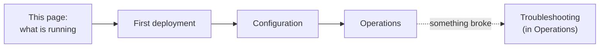
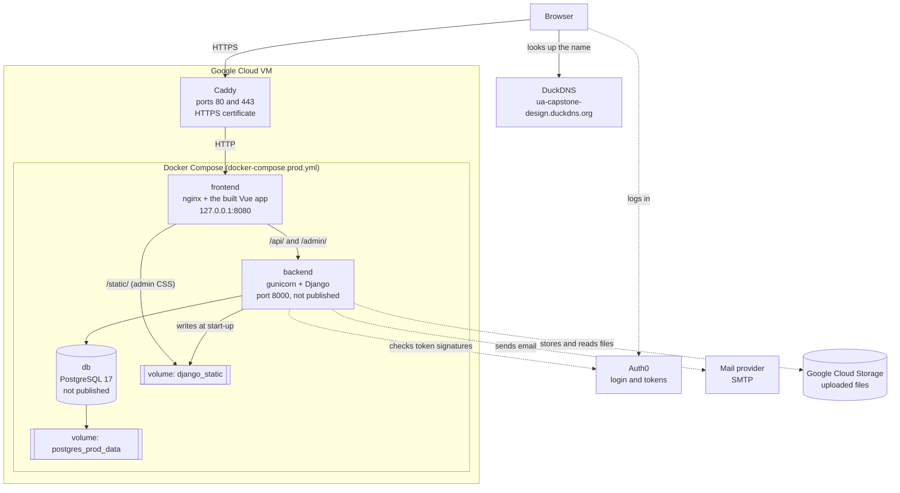

# Deployment Guide

**Audience:** whoever hosts the site: the next team, the sponsor, or a department administrator. How the production site is put together, how to build it from nothing, and how to keep it running.

This guide describes the production setup on `main` as of 2026-11-20. It replaces the previous team's [`deployment.pdf`](../investigations/v1/README.md), which describes a Google Cloud project, a domain, and a `Cloud-V2` branch that no longer exist.

## Start here

| Page | What it answers |
|---|---|
| This page | What is running, where, and how the pieces connect. What is confirmed and what the VM's owner still has to write down. |
| [First deployment](first-deployment.md) | How do I bring the site up on a new server, step by step, from an empty VM to a working login? |
| [Configuration](configuration.md) | Which files hold the settings, what does every variable do, and what has to be set in Auth0, the mail provider, and Google Cloud Storage? |
| [Operations](operations.md) | How do I deploy a new version, roll back, read the logs, back up and restore the database, send the deadline reminders, and fix the common failures? |

## The production system in one picture

How one request travels:

1. The browser reaches **Caddy** on the VM over HTTPS. Caddy holds the certificate and forwards plain HTTP to `127.0.0.1:8080`.
2. **nginx**, in the `frontend` container, answers on that port. It serves the built Vue app for most paths, and passes `/api/` and `/admin/` on to the backend. `/static/` is served from a volume that Django fills at start-up.
3. **gunicorn**, in the `backend` container, runs Django with two workers. It is reachable only from inside the Compose network.
4. **PostgreSQL**, in the `db` container, keeps its data in the `postgres_prod_data` volume. It is not reachable from outside the VM.

Only the `frontend` container publishes a port, and only on the VM's loopback address. Nothing in Compose is reachable from the internet except through Caddy.

## What is deployed today

Checked from outside the VM on 2026-11-20.

| Fact | Value | How it was checked |
|---|---|---|
| Address | https://ua-capstone-design.duckdns.org | Opened it |
| IP address | `34.132.126.69` (Google Cloud) | DNS lookup |
| Health | `{"status": "healthy", "database": "connected"}` | `GET /api/v1/health/` |
| HTTPS | Let's Encrypt certificate, valid to 2027-01-24. HTTP redirects to HTTPS | Certificate and a plain HTTP request |
| Front of the VM | Caddy, then nginx | Response headers `via: 1.1 Caddy`, `server: nginx` |
| Version running | **The frontend was last built on 2026-10-27.** Everything merged since (Iteration 3) is not on the live site | `Last-Modified` header of the home page |

Two things follow from that table:

- **The live site is behind `main`.** Bring it up to date with the steps in [Operations: deploy a new version](operations.md#deploy-a-new-version).
- **The certificate renews itself** as long as Caddy is running and ports 80 and 443 stay open. Nobody has to act before 2027-01-24.

## What only the VM's owner can confirm

These facts are not in the repository, by design for the secrets and by omission for the rest. Noland Miller set up the VM (PR #59). Each row should be filled in here, or in the [FAQ](../faq/README.md) for account ownership, before handoff.

| Question | Why it matters |
|---|---|
| Which Google Cloud project and billing account own the VM? Who can log in after the semester? | Without an owner the site disappears when credits or a student account end |
| VM name, zone, machine type, and operating system | Needed for `gcloud compute ssh` and for sizing a replacement |
| Is the external IP reserved (static)? | An ephemeral IP changes when the VM stops, and the DuckDNS name then points nowhere |
| Who owns the DuckDNS account for `ua-capstone-design`? | The name can only be repointed from that account |
| Where is the repository checked out on the VM, and which commit is running? | Every command in this guide runs from that folder |
| Where is the Caddyfile, and does it set a request size limit? | Uploads up to 25 MB must pass through it |
| Is `GS_BUCKET_NAME` set, and which bucket? | Without it, uploaded files are stored inside the container and lost on the next rebuild. See [Configuration: uploaded files](configuration.md#uploaded-files) |
| Which Auth0 tenant does the live site use? | #58 (switch to the team tenant) is still open |
| Is anything backing up the database? | Nothing in the repository does. See [Operations: backups](operations.md#back-up-the-database) |
| Is the deadline reminder scheduled? | It only runs if a cron job calls it. See [Operations: deadline reminders](operations.md#deadline-reminders) |

## Development and production side by side

| | Development | Production |
|---|---|---|
| Compose file | `docker-compose.dev.yml` | `docker-compose.prod.yml` |
| Settings files | `.env.dev`, `.env.dev.db`, `frontend/.env.dev.local` | `.env.production`, `.env.production.db`, `.env` |
| Frontend | Vite dev server on 5173, reloads on save | Built once into static files, served by nginx |
| Backend | Django's development server, code mounted from your disk | gunicorn, code copied into the image, runs as a non-root user |
| `DEBUG` | `1` | `0` |
| Login settings | Read when the dev server starts | **Baked into the frontend at build time.** Changing them means rebuilding |
| Uploaded files | MinIO container | Google Cloud Storage, when `GS_BUCKET_NAME` is set |
| Email | Mailhog container, nothing leaves your machine | A real SMTP provider |
| Migrations | You run them | Run automatically every time the backend starts |
| HTTPS | None | Caddy, with an automatic certificate |

## How this guide was checked

On 2026-11-20 the production stack was built and started from a clean copy of `main` on a laptop (Docker 29.5, Compose v5.1), following the steps in [First deployment](first-deployment.md) with `localhost:8080` in place of the domain. Checked in that run:

- All three containers start and the backend reports healthy.
- The home page, a deep link into the Vue app, `/admin/`, the admin's CSS, and the API all answer correctly through nginx.
- A superuser can be created and can log in to `/admin/`.
- The database backup and restore commands in [Operations](operations.md) work: a deleted row came back.
- The reference Caddyfile passes `caddy validate`.

That run found one defect, fixed in the same pull request as this guide: a first start on a new server failed because the backend, running as a non-root user, could not write to the static files volume. `backend/Dockerfile.prod` now creates that folder with the right owner.

Not checked, because they need the real server or real accounts: Caddy obtaining a certificate, Google Cloud Storage, real email delivery, and the `gcloud` commands. Those steps follow each tool's own documentation and are marked where they appear. The issue this guide belongs to (#83) asks for someone other than the author to redeploy from it; that run on the VM is still to be done.
