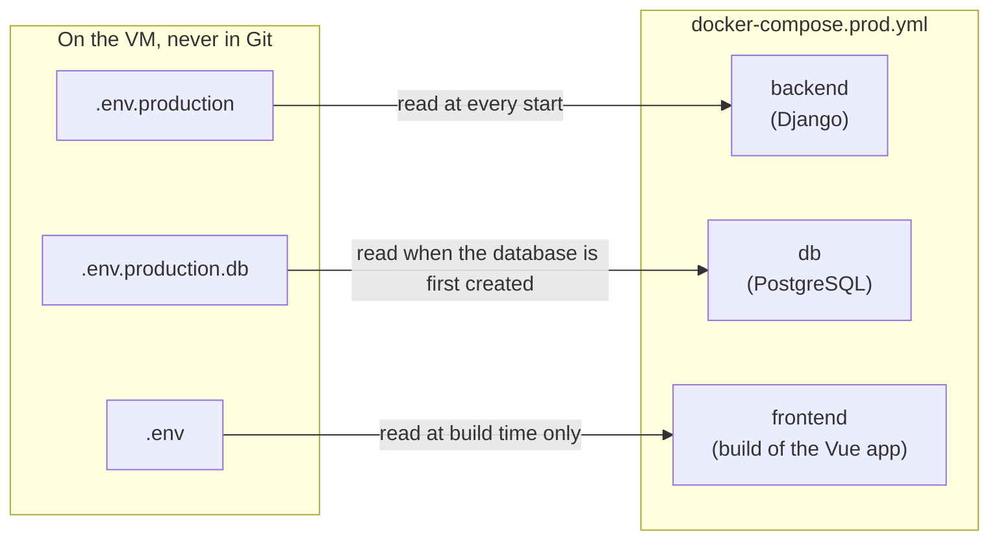
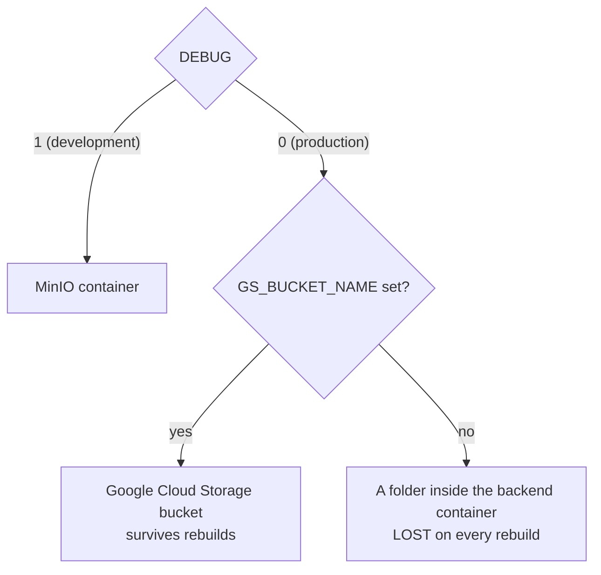

# Configuration

**Audience:** whoever hosts the site. Which files hold the production settings, what every variable does, and what has to be set up outside the server: Auth0, the mail provider, and Google Cloud Storage.

All settings come from environment variables. `backend/core/settings.py` reads them; nothing is hard-coded per environment. The variable names below were taken from that file and from `docker-compose.prod.yml` on `main` as of 2026-11-20.

## The three files

| File | Read by | When | What goes in it |
|---|---|---|---|
| `.env.production` | The backend container | Every time it starts | Everything Django needs: secret key, hosts, database login, Auth0, email, storage |
| `.env.production.db` | The database container | Only when the database volume is first created | The database name, user, and password |
| `.env` | Docker Compose itself | When the frontend image is built | The three `VITE_AUTH0_*` values |

Three things about these files cause most configuration mistakes:

- **The frontend's values are baked in at build time.** Vite writes them into the JavaScript bundle. Changing `.env` does nothing until you rebuild: `docker compose -f docker-compose.prod.yml up --build -d`.
- **The frontend's values do not come from `.env.production`.** Compose fills `${VITE_AUTH0_DOMAIN}` and the other two from its own `.env` file (or from the shell), not from a service's `env_file`. If `.env` is missing, the build succeeds with empty values and login fails in the browser.
- **The database password is fixed at creation.** PostgreSQL reads `.env.production.db` only when the volume is empty. Editing the password later changes what Django sends but not what the database expects. See [Operations: change the database password](operations.md#change-the-database-password).

`.gitignore` excludes every `.env*` file except the three example templates. The examples in the repository (`.env.example`, `.env.example.db`, `frontend/.env.example.local`) are development values; do not copy them to production unchanged.

## `.env.production`

### Required

| Variable | Example | What it does | If it is wrong |
|---|---|---|---|
| `SECRET_KEY` | 50 or more random characters | Signs sessions and the assignment proposal tokens | Changing it logs every admin out and invalidates any proposal waiting for approval |
| `DEBUG` | `0` | `0` in production, always | With `1`, error pages show settings and code to visitors, and uploads go to the MinIO backend, which does not exist in production |
| `DJANGO_ALLOWED_HOSTS` | `capstone.example.org` | The host names Django answers to, separated by spaces | Every page returns "Bad Request (400)" |
| `CSRF_TRUSTED_ORIGINS` | `https://capstone.example.org` | Origins allowed to submit forms, separated by spaces. Include `https://` | The admin login returns "Forbidden (403) CSRF verification failed" |
| `CORS_ALLOWED_ORIGINS` | `https://capstone.example.org` | Origins allowed to call the API from a browser | Only matters if the Vue app is ever served from a different address than the API |
| `SQL_ENGINE` | `django.db.backends.postgresql` | The database driver | If unset, Django silently uses a SQLite file inside the container, and all data is lost on the next rebuild |
| `SQL_DATABASE`, `SQL_USER`, `SQL_PASSWORD` | `capstone`, `capstone`, a password | The database login. Must match `.env.production.db` | The backend restarts in a loop with "password authentication failed" |
| `AUTH0_DOMAIN` | `dev-hx43g1ojtwfadqxq.us.auth0.com` | The Auth0 tenant whose tokens the API accepts | Every API call returns 401 or 403 after login |
| `AUTH0_CLIENT_ID` | `BOkoyrtYS8B7SbsVnVH4urjEzzOMrlF3` | The single-page application in that tenant | Same |
| `AUTH0_AUDIENCE` | `https://backend-api-capstone/` | The API identifier. The trailing slash is part of it | Same |

`SQL_HOST`, `SQL_PORT`, and `DATABASE` are set by `docker-compose.prod.yml` itself (`db`, `5432`, `postgres`). Leave them out of the file.

The Auth0 domain and client ID are not secrets: every visitor's browser receives them. The secrets in this file are `SECRET_KEY`, `SQL_PASSWORD`, and `EMAIL_HOST_PASSWORD`.

### Addresses used in links

| Variable | Example | Used for |
|---|---|---|
| `APP_BASE_URL` | `https://capstone.example.org` | The "View site" link at the top of Django admin |
| `APP_URL` | `https://capstone.example.org` | The links in emails to students |

Both default to a `localhost` address, so both have to be set. They are two variables for the same address; merging them is on the list of recommendations.

### Email

| Variable | Default | What it does |
|---|---|---|
| `EMAIL_BACKEND` | Console (prints to the log) | Set to `django.core.mail.backends.smtp.EmailBackend` to send real mail |
| `EMAIL_HOST`, `EMAIL_PORT` | `localhost`, `1025` | The provider's SMTP server and port, usually 587 |
| `EMAIL_USE_TLS` | `False` | `True` for port 587. The value is compared to the exact text `True` |
| `EMAIL_HOST_USER`, `EMAIL_HOST_PASSWORD` | Empty | The SMTP login |
| `DEFAULT_FROM_EMAIL` | `noreply@example.com` | The sender address. Most providers reject mail unless this is an address they have verified |
| `EMAIL_FAIL_SILENTLY` | `False` | Leave `False`, so that a failed send is reported to the admin |
| `ALLOW_STUDENT_EMAILS` | `False` | **Must be `True` in production.** See below |
| `DEADLINE_REMINDER_DAYS` | `3` | How many days before the ranking deadline the reminder goes out |
| `CAPSTONE_YEAR` | The current year | The year in the subject of sponsor outreach emails |

`ALLOW_STUDENT_EMAILS` is a safety switch. Unless the mail server is a local catcher (the console, Mailhog), the code refuses to email students at all while this is `False`, so that a developer testing against a real SMTP server cannot mail a real roster by accident. On the production site it has to be `True`, or approving an assignment saves the teams but emails nobody, and the reminder command stops with an error.

The team tested delivery through SMTP2GO and through Gmail with an App Password; [the investigation](../investigations/mailhog-to-smtp2go.md) records both, with the pitfalls. For production, use a sending account the instructor controls, not a student's.

### Uploaded files

Sponsors can attach files to a project, up to 25 MB each. Where those files are stored depends on one variable.

| Variable | Default | What it does |
|---|---|---|
| `GS_BUCKET_NAME` | Unset | The Google Cloud Storage bucket for uploads |
| `GS_PROJECT_ID` | `capstone-design-fall-2026` | The Google Cloud project that owns the bucket |

**Without `GS_BUCKET_NAME`, uploads are written to `/usr/src/app/media` inside the backend container.** That folder is not a volume, so every `up --build` (that is, every deployment) deletes all uploaded files, while the database still lists them. Do not run a real semester in that state.

To use a bucket (these steps follow Google's and django-storages' documentation and have not been run by this team end to end):

1. Create a bucket in the same project as the VM, with public access prevention on. A region in `us-central1`, `us-east1`, or `us-west1` falls under Google's free tier for the first 5 GB.
2. Give the VM's service account the *Storage Object Admin* role on that bucket.
3. Make sure the VM's access scope for Storage is *Read Write* (or the VM uses the *cloud-platform* scope). The default scope is read-only, and changing it requires stopping the VM.
4. Add `GS_BUCKET_NAME=<bucket>` and, if the project is not the default above, `GS_PROJECT_ID=<project-id>` to `.env.production`, then restart the backend.

No key file is needed: on a Google Cloud VM the storage library gets its credentials from the VM's service account. Downloads go through Django, which checks the user's permission and then streams the file, so the bucket stays private and no signed URLs are involved. Background and the alternatives considered are in the [file hosting investigation](../investigations/file-hosting.md).

The same requests pass through two proxies on the way in. nginx allows 30 MB (`frontend/nginx.conf`). Caddy has no limit unless its Caddyfile sets one.

### Optional

| Variable | Default | What it does |
|---|---|---|
| `GUNICORN_WORKERS` | `2` | Number of backend worker processes. Two is enough for a class |

## `.env.production.db`

| Variable | Must equal |
|---|---|
| `POSTGRES_DB` | `SQL_DATABASE` |
| `POSTGRES_USER` | `SQL_USER` |
| `POSTGRES_PASSWORD` | `SQL_PASSWORD` |

## `.env`

| Variable | Must equal |
|---|---|
| `VITE_AUTH0_DOMAIN` | `AUTH0_DOMAIN` |
| `VITE_AUTH0_CLIENT_ID` | `AUTH0_CLIENT_ID` |
| `VITE_AUTH0_AUDIENCE` | `AUTH0_AUDIENCE` |

If the browser and the backend disagree on any of these, login succeeds in the browser and then every API call is rejected.

## Settings outside the server

### Auth0

The tenant, the API, the application, the post-login Action, and the `admin` role are described in [Auth0 setup](../development-guide/auth0-setup.md). For a hosted site, one more thing is needed. In *Applications > Applications >* the single-page application, each of these lists must contain the site's address, with `https://` and without a path:

| List | Symptom when the address is missing |
|---|---|
| Allowed Callback URLs | Auth0 shows "Callback URL mismatch" after login |
| Allowed Logout URLs | Logging out lands on an Auth0 error page |
| Allowed Web Origins | The user is logged out on every page refresh |

Before handoff, the sponsor should be a tenant admin (step 6 of the Auth0 setup), so that the tenant does not depend on a student's account.

### DNS

One A record: the domain to the VM's external IP. If the IP ever changes, update the record; nothing on the server needs to change, and Caddy renews the certificate as before.

### Who can sign in as what

Not a deployment setting, but the first question after a deployment:

| Role | How a person gets it |
|---|---|
| Student | Their `@crimson.ua.edu` email is in the Students table (imported from the Blackboard roster), and they sign up with it |
| Sponsor | They sign up with any other email |
| Instructor | A Django staff account created with `createsuperuser` or in admin |

## Changing a setting

| What changed | What to run |
|---|---|
| Anything in `.env.production` | `docker compose -f docker-compose.prod.yml up -d --force-recreate backend` |
| Anything in `.env` | `docker compose -f docker-compose.prod.yml up --build -d` |
| The Caddyfile | `sudo systemctl reload caddy` |
| `.env.production.db` | Nothing happens by itself. See [Operations: change the database password](operations.md#change-the-database-password) |

A plain `restart` is not enough for `.env.production`: Compose reads the file when it creates the container, not when it restarts it.
