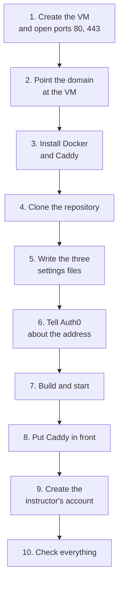

# First Deployment

**Audience:** someone bringing the site up on a new server. You need to be comfortable with a Linux terminal and SSH. You do not need to know Django or Vue.

Follow the steps in order. Each ends with a check; do not go on until the check passes. Allow about an hour, most of it waiting for a VM and for images to build.



Throughout, replace `capstone.example.org` with your own domain. The current site uses `ua-capstone-design.duckdns.org`.

## Before you start

You need:

- A Google Cloud project with billing enabled, or any other Linux server with a public IP address. Nothing in the application depends on Google Cloud except the optional file storage.
- A domain name you control. A free [DuckDNS](https://www.duckdns.org) subdomain is what the current site uses.
- Admin access to the team's Auth0 tenant. See [Auth0 setup](../development-guide/auth0-setup.md).
- An SMTP account for sending email. See [Configuration: email](configuration.md#email).

## 1. Create the VM

Any current Debian or Ubuntu LTS image works. Sizing:

| Resource | Minimum | Why |
|---|---|---|
| Memory | 2 GB | The running site used about 180 MB in our test (backend 124 MB, database 45 MB, nginx 10 MB). Building the images needs far more than running them |
| Disk | 20 GB | The backend image is about 840 MB, mostly the assignment solver. Old images accumulate until pruned |
| Network | A reserved (static) external IP | An ephemeral IP changes when the VM is stopped |

In the firewall, allow inbound TCP **80** and **443** from anywhere, and **22** for SSH. Port 80 has to stay open: Caddy uses it to obtain and renew the certificate.

On Google Cloud, the console's *Compute Engine > Create instance* page covers all of this: tick "Allow HTTP traffic" and "Allow HTTPS traffic", and reserve the IP under *VPC network > IP addresses*. If the site will store uploads in Google Cloud Storage, set the VM's access scope for Storage to **Read Write** now; changing it later means stopping the VM. See [Configuration: uploaded files](configuration.md#uploaded-files).

**Check:** you can SSH in.

```
gcloud compute ssh <vm-name> --zone=<zone> --project=<project-id>
```

## 2. Point the domain at the VM

Create a DNS A record for your domain with the VM's external IP. With DuckDNS, log in, type the IP beside your subdomain, and click *update ip*.

**Check:** from your own machine, the name resolves to the VM's IP.

```
dig +short capstone.example.org
```

## 3. Install Docker and Caddy

Install both from their official packages, on the VM:

- Docker Engine with the Compose plugin: https://docs.docker.com/engine/install/
- Caddy: https://caddyserver.com/docs/install

Add your user to the `docker` group so the commands below work without `sudo`, then log out and back in:

```
sudo usermod -aG docker $USER
```

**Check:**

```
docker compose version
caddy version
```

## 4. Clone the repository

```
git clone https://github.com/monicadelaine/capstone-design.git
cd capstone-design
```

Every command from here on runs in this folder.

## 5. Write the three settings files

Production reads three files that are never committed. Create them by hand on the VM. [Configuration](configuration.md) explains every line; this is the minimum that works.

**`.env.production`**, read by the backend:

```
SECRET_KEY=<a long random string, see below>
DEBUG=0
DJANGO_ALLOWED_HOSTS=capstone.example.org
CORS_ALLOWED_ORIGINS=https://capstone.example.org
CSRF_TRUSTED_ORIGINS=https://capstone.example.org
APP_BASE_URL=https://capstone.example.org
APP_URL=https://capstone.example.org

SQL_ENGINE=django.db.backends.postgresql
SQL_DATABASE=capstone
SQL_USER=capstone
SQL_PASSWORD=<a database password you choose>

AUTH0_DOMAIN=dev-hx43g1ojtwfadqxq.us.auth0.com
AUTH0_CLIENT_ID=BOkoyrtYS8B7SbsVnVH4urjEzzOMrlF3
AUTH0_AUDIENCE=https://backend-api-capstone/

EMAIL_BACKEND=django.core.mail.backends.smtp.EmailBackend
EMAIL_HOST=<your SMTP host>
EMAIL_PORT=587
EMAIL_USE_TLS=True
EMAIL_HOST_USER=<SMTP login>
EMAIL_HOST_PASSWORD=<SMTP password>
DEFAULT_FROM_EMAIL=<the address mail is sent from>
ALLOW_STUDENT_EMAILS=True
```

**`.env.production.db`**, read by PostgreSQL. The three values must match `SQL_DATABASE`, `SQL_USER`, and `SQL_PASSWORD` above:

```
POSTGRES_DB=capstone
POSTGRES_USER=capstone
POSTGRES_PASSWORD=<the same database password>
```

**`.env`**, read by Docker Compose when it builds the frontend. The three values must match the `AUTH0_*` lines above:

```
VITE_AUTH0_DOMAIN=dev-hx43g1ojtwfadqxq.us.auth0.com
VITE_AUTH0_CLIENT_ID=BOkoyrtYS8B7SbsVnVH4urjEzzOMrlF3
VITE_AUTH0_AUDIENCE=https://backend-api-capstone/
```

Generate the secret key with:

```
python3 -c "import secrets; print(secrets.token_urlsafe(50))"
```

Then keep the files readable only by you:

```
chmod 600 .env.production .env.production.db .env
```

**Check:** `git status` shows a clean tree. All three names are ignored by Git; if one shows up, stop and fix the name before going on.

## 6. Tell Auth0 about the address

Auth0 refuses to send users back to an address it has not been told about. In the Auth0 dashboard, open *Applications > Applications >* the single-page application, and add `https://capstone.example.org` to all three of these lists, keeping the `http://localhost:5173` entries:

- Allowed Callback URLs
- Allowed Logout URLs
- Allowed Web Origins

Save.

## 7. Build and start

```
docker compose -f docker-compose.prod.yml up --build -d
```

The first build takes several minutes. When it finishes, the backend waits for the database, applies all migrations, and collects the admin's static files before it starts serving. Give it half a minute, then:

**Check:** all three services are up and the backend says `healthy`.

```
docker compose -f docker-compose.prod.yml ps
curl http://127.0.0.1:8080/api/v1/health/
```

Expected:

```
{"status": "healthy", "database": "connected"}
```

If the backend shows `Restarting`, read its log before doing anything else: `docker compose -f docker-compose.prod.yml logs backend --tail 50`. [Troubleshooting](operations.md#troubleshooting) lists the usual causes.

## 8. Put Caddy in front

Replace the contents of `/etc/caddy/Caddyfile` with:

```
capstone.example.org {
    reverse_proxy 127.0.0.1:8080
}
```

Then reload:

```
sudo systemctl reload caddy
```

Caddy obtains a Let's Encrypt certificate on its own within about a minute, renews it without help, and redirects HTTP to HTTPS. It also tells the application that the original request was HTTPS (the `X-Forwarded-Proto` header), which nginx passes on and Django trusts.

This Caddyfile is the smallest one that works, and it passes `caddy validate`. The Caddyfile on the current VM is not in the repository and may differ.

**Check:** from your own machine,

```
curl https://capstone.example.org/api/v1/health/
```

returns the same healthy answer as in step 7.

## 9. Create the instructor's account

The instructor works in Django admin, which has its own accounts, separate from Auth0. Create the first one:

```
docker compose -f docker-compose.prod.yml exec backend python manage.py createsuperuser
```

Use a strong password and store it in a password manager. More staff accounts can be created afterwards inside the admin, under *Authentication and Authorization > Users*.

**Check:** log in at `https://capstone.example.org/admin/`. The page is styled (if it is plain black text on white, static files are not being served; see [Troubleshooting](operations.md#troubleshooting)).

## 10. Check everything

| Check | How | Expected |
|---|---|---|
| The site loads | Open `https://capstone.example.org` | The landing page |
| Sponsor login | Sign up with a non-university email, verify it, log in | The sponsor profile form, then the dashboard |
| Student login | In admin, add a student with your `@crimson.ua.edu` email. Sign up with it, verify, log in | The student dashboard |
| Admin | Open `/admin/` | Styled pages; Semesters, Projects, Students are listed |
| Email | In admin under *Users > Sponsors*, select a sponsor whose address is your own and run *Send Sponsor Outreach Email* | The message arrives. It also appears under *Emails > Email logs* |
| Uploads | As a sponsor, attach a file to a project. As a student, download it | The same file comes back |
| Uploads survive a rebuild | Rebuild (`up --build -d`), then download the file again | Still there. If it is gone, `GS_BUCKET_NAME` is not set |

Do not run `python manage.py seed_demo` on the production site. It fills the database with made-up sponsors, students, and projects.

When every row passes, set up the two scheduled jobs in [Operations](operations.md): the database backup and the deadline reminder.
