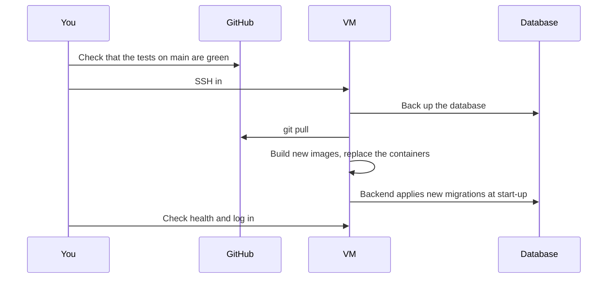

# Operations

**Audience:** whoever keeps the site running. Deploying a new version, rolling back, reading logs, backups, the scheduled reminder, and what to do when something breaks.

Every command runs on the VM, in the folder where the repository is checked out. To save typing, this page uses `dc` for the Compose command. Define it once per session:

```
alias dc='docker compose -f docker-compose.prod.yml'
```

## Deploy a new version

There is no automatic deployment. Merging a pull request into `main` runs the tests on GitHub and changes nothing on the server. Deploying is these steps, by hand:



```
git rev-parse --short HEAD          # write this down: it is what you roll back to
dc exec -T db sh -c 'pg_dump -U "$POSTGRES_USER" -d "$POSTGRES_DB" --format=custom' > backups/before-deploy-$(date +%F).dump
git pull origin main
dc up --build -d
dc ps
curl http://127.0.0.1:8080/api/v1/health/
```

Create the `backups` folder first if it does not exist (`mkdir -p backups`).

What happens during `up --build -d`:

- Both images are rebuilt. The site stays up on the old containers while this runs.
- The containers are replaced. For roughly half a minute the API returns "502 Bad Gateway" while the new backend applies migrations and starts.
- The database container is left alone unless its own settings changed. Data is in a volume and is not touched.

Afterwards, open the site, log in, and open `/admin/`. If the change included a migration, check the page it affects.

Old images pile up. Every few deployments, reclaim the disk:

```
docker image prune -f
```

## Roll back

Going back to an earlier version is the same procedure with an older commit:

```
git checkout <the commit you wrote down>
dc up --build -d
```

That restores the code. **It does not undo database migrations.** If the version you are leaving added a migration, the older code now runs against a newer database. Three cases:

| The newer version's migration | What to do |
|---|---|
| None | Nothing more. The rollback is complete |
| Added a column or table the old code never reads | Usually nothing. The old code ignores it |
| Removed or renamed something the old code needs | Restore the backup taken before the deployment (below). Anything entered since that backup is lost |

When the problem is fixed on `main`, return with `git checkout main && git pull origin main && dc up --build -d`.

## Logs and health

| To see | Run |
|---|---|
| What is running | `dc ps` |
| Backend log, live | `dc logs -f backend` |
| The last 100 backend lines | `dc logs backend --tail 100` |
| Requests reaching nginx | `dc logs frontend --tail 100` |
| Database log | `dc logs db --tail 50` |
| Caddy (HTTPS, certificates) | `sudo journalctl -u caddy --since "1 hour ago"` |
| Is the app healthy | `curl https://<domain>/api/v1/health/` |
| Disk space | `df -h` and `docker system df` |

The health address returns `{"status": "healthy", "database": "connected"}` with status 200 when Django can reach the database, and status 503 when it cannot. Docker calls it every 30 seconds; `dc ps` shows the result as `(healthy)` or `(unhealthy)`. Point any outside uptime monitor at the same address.

Every email the application sends is listed in Django admin under *Emails > Email logs*, with whether it succeeded.

One line in the backend log looks like an error and is not: `Control server error: [Errno 13] Permission denied: '/nonexistent'`. gunicorn tries to create a control socket in the home folder of the non-root user, which has none. The site is unaffected.

## Back up the database

Everything the instructor, sponsors, and students enter is in PostgreSQL: semesters, projects, the roster, rankings, assignments, the email log. **Nothing in the repository backs it up.** Until one of the options below is in place, deleting the VM or the volume loses the semester.

### By hand

```
mkdir -p backups
dc exec -T db sh -c 'pg_dump -U "$POSTGRES_USER" -d "$POSTGRES_DB" --format=custom' > backups/capstone-$(date +%F).dump
```

A database for one class is small; the file is well under a megabyte when empty and grows slowly. Do this before every deployment and before each of the three moments when the data is hardest to recreate: after the roster import, after the ranking deadline, and after assignments are approved.

### Every night

Save this as `backup.sh` in the repository folder on the VM, make it executable (`chmod +x backup.sh`), and adjust the path:

```
#!/bin/sh
set -e
cd /home/<user>/capstone-design
mkdir -p backups
docker compose -f docker-compose.prod.yml exec -T db \
    sh -c 'pg_dump -U "$POSTGRES_USER" -d "$POSTGRES_DB" --format=custom' \
    > backups/capstone-$(date +%F).dump
find backups -name 'capstone-*.dump' -mtime +14 -delete
```

Then add it to cron with `crontab -e`:

```
15 8 * * * /home/<user>/capstone-design/backup.sh >> /home/<user>/backup.log 2>&1
```

Google Cloud VMs keep UTC time by default, so 08:15 is 2:15 or 3:15 in the morning in Tuscaloosa. Fourteen daily files are kept.

### Off the VM

A backup stored on the same disk as the database does not survive losing the VM. Do at least one of these:

| Option | How | Covers |
|---|---|---|
| Copy the dumps to a bucket | Add `gcloud storage cp backups/capstone-$(date +%F).dump gs://<backup-bucket>/` to the end of `backup.sh` | The database |
| Snapshot the disk on a schedule | Google Cloud console: *Compute Engine > Snapshots > Create snapshot schedule*, attach it to the VM's disk | Everything on the VM, including the settings files and the Caddyfile |

Neither has been set up or tested by this team. The snapshot schedule is the less work of the two and also protects the three settings files, which exist nowhere else.

Uploaded files are not in the database. With `GS_BUCKET_NAME` set they live in the bucket, which Google stores redundantly; turn on object versioning on the bucket to guard against accidental deletion.

### Restore

Restoring replaces the whole database with the contents of the dump. Stop the backend first so nothing writes during the restore:

```
dc stop backend
dc exec -T db sh -c 'pg_restore -U "$POSTGRES_USER" -d "$POSTGRES_DB" --clean --if-exists --no-owner' < backups/capstone-2026-11-20.dump
dc start backend
curl http://127.0.0.1:8080/api/v1/health/
```

When the backend starts it applies any migrations newer than the dump, so an older backup works with newer code.

These backup and restore commands were run against the production stack on 2026-11-20: a row deleted after the dump was back after the restore. Test a restore yourself once before you depend on it.

## Deadline reminders

The reminder to students who have not ranked their projects is a command, not something the site does by itself. It has to be called once a day. Add to `crontab -e`:

```
0 14 * * * cd /home/<user>/capstone-design && docker compose -f docker-compose.prod.yml exec -T backend python manage.py send_deadline_reminders >> /home/<user>/reminders.log 2>&1
```

Most days it prints "No semester is due for a reminder." and exits. When a semester's ranking deadline is within `DEADLINE_REMINDER_DAYS` days (3 by default), it emails each student who has saved no rankings, once, and records that the semester was reminded.

| To | Run |
|---|---|
| See who would be emailed, without sending | `dc exec -T backend python manage.py send_deadline_reminders --dry-run` |
| Send now | `dc exec -T backend python manage.py send_deadline_reminders` |
| Send again to a semester already reminded | Add `--force` |

Two things to know before the first reminder of a semester:

- It needs `ALLOW_STUDENT_EMAILS=True` in `.env.production`. Otherwise it stops with an error and sends nothing.
- It emails every student in the Students table who has no rankings, including students left over from earlier semesters. Run `--dry-run` first and remove old students in admin if the list is wrong.

The other student email, "your assignment is posted", needs no schedule. It is sent when the instructor approves a proposed assignment.

## Accounts

| Task | How |
|---|---|
| Create another instructor account | In admin: *Authentication and Authorization > Users > Add user*, then tick *Staff status* and either *Superuser status* or the specific permissions |
| Reset an instructor's password | `dc exec backend python manage.py changepassword <username>` |
| Remove someone's access | In admin, untick *Active* on their user. Do this for every team member's account at handoff |
| A student cannot log in | Check that their `@crimson.ua.edu` email is in the Students table and that they verified their email with Auth0 |

Students and sponsors have no password on this server. Their accounts are in Auth0, under *User Management > Users*.

## Change the database password

PostgreSQL only reads `.env.production.db` when its volume is first created, so the password has to be changed inside the database and in the backend's file together:

```
dc exec db sh -c 'psql -U "$POSTGRES_USER" -d "$POSTGRES_DB"'
```

At the prompt, with your own user name and new password:

```
ALTER USER capstone WITH PASSWORD 'the-new-password';
\q
```

Then set the same value as `SQL_PASSWORD` in `.env.production` and `POSTGRES_PASSWORD` in `.env.production.db`, and recreate the backend:

```
dc up -d --force-recreate backend
```

## Certificates

Caddy renews the Let's Encrypt certificate by itself, about a month before it expires. It needs ports 80 and 443 open and the domain pointing at the VM. If the site ever shows an expired certificate, the cause is in `sudo journalctl -u caddy`, and it is almost always one of those two.

## Stop and start

| To | Run | Data |
|---|---|---|
| Stop the site | `dc down` | Kept |
| Start it again | `dc up -d` | Kept |
| Restart only the backend | `dc restart backend` | Kept |
| **Delete the database** | `dc down -v` | **Lost.** `-v` removes the volumes. Never run this on the production server without a backup you have tested |

All three containers are set to `restart: unless-stopped`, so they come back by themselves after the VM reboots, as does Caddy.

## Troubleshooting

Start with `dc ps`, then the log of whichever service is not `Up`.

| Symptom | Likely cause | Fix |
|---|---|---|
| "502 Bad Gateway" on `/api/` and `/admin/`, home page loads | The backend is down or still starting | Wait 30 seconds after a deployment. Otherwise `dc logs backend --tail 50` |
| Backend restarts in a loop; log ends with `PermissionError ... /usr/src/app/staticfiles` | An image built before 2026-11-20, whose static files volume belongs to root | `git pull` and `dc up --build -d`. The current `Dockerfile.prod` creates the folder with the right owner |
| Backend restarts in a loop; log says `password authentication failed` | `.env.production` and the database disagree on the password | See [Change the database password](#change-the-database-password) |
| Backend log stops at "Waiting for PostgreSQL..." | The database container is not running | `dc logs db --tail 50`; usually a full disk |
| "Bad Request (400)" on every page | The domain is missing from `DJANGO_ALLOWED_HOSTS` | Fix it in `.env.production`, then `dc up -d --force-recreate backend` |
| Admin login returns "Forbidden (403) CSRF verification failed" | The address is missing from `CSRF_TRUSTED_ORIGINS`, or lacks `https://` | Same |
| Admin pages are unstyled | Static files were not collected, or nginx cannot see the volume | `dc logs backend` should show "Collecting static files". `dc up -d --force-recreate frontend backend` |
| "Callback URL mismatch" from Auth0 | The address is not in the application's Allowed Callback URLs | [Configuration: Auth0](configuration.md#auth0) |
| Login works, then every page says unauthorized, or loops back to login | The frontend and backend use different Auth0 values, or `.env` was missing at build time | Make the three values match in `.env` and `.env.production`, then `dc up --build -d` |
| Logged out on every refresh | The address is not in Allowed Web Origins | [Configuration: Auth0](configuration.md#auth0) |
| A changed `VITE_*` value has no effect | The frontend was not rebuilt | `dc up --build -d` |
| A changed `.env.production` value has no effect | The container was restarted, not recreated | `dc up -d --force-recreate backend` |
| Upload fails with "413 Request Entity Too Large" | A proxy limit. nginx allows 30 MB; check the Caddyfile for `request_body` | Raise or remove the limit, reload Caddy |
| Uploaded files are missing after a deployment | `GS_BUCKET_NAME` is not set | [Configuration: uploaded files](configuration.md#uploaded-files). The lost files cannot be recovered |
| Approving an assignment warns that emails could not be sent | `ALLOW_STUDENT_EMAILS` is not `True`, or the SMTP login is wrong | Fix `.env.production`, then recreate the backend. The assignments are saved either way, and the warning gives the reason |
| The build is killed, or the VM freezes while building | Not enough memory | Use a VM with at least 2 GB, or add swap |
| "no space left on device" | Old images | `docker image prune -f`; `docker system df` shows what is using the space |
| The browser cannot reach the site at all | DNS, the firewall, or Caddy | `dig +short <domain>` should give the VM's IP. Ports 80 and 443 must be open. `sudo systemctl status caddy` |

## Known gaps

What the production setup does not do today. Each is a candidate for the [recommendations](../recommendations/README.md).

| Gap | Effect |
|---|---|
| No automatic deployment | The live site falls behind `main` unless someone deploys by hand. On 2026-11-20 it was running a build from 2026-10-27 |
| No backup in the repository | Backups exist only if someone sets up the jobs above |
| Uploads are lost on rebuild unless a bucket is configured | See [Configuration: uploaded files](configuration.md#uploaded-files) |
| The settings files and the Caddyfile exist only on the VM | Losing the VM loses them. Keep a copy in the instructor's password manager or in disk snapshots |
| Django's deployment check reports four warnings | `python manage.py check --deploy` flags that secure cookies, HSTS, and the HTTPS redirect are not switched on in `settings.py`. Caddy already redirects HTTP to HTTPS, so the practical gap is the two cookie flags |
| Brief downtime on every deployment | About half a minute of 502 responses while the backend restarts |
| One VM, no monitoring | Nobody is told when the site is down. A free uptime monitor pointed at the health address would close this |
