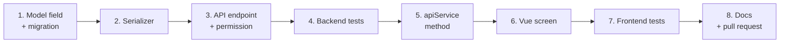

# Adding a Feature

**Audience:** developers. A worked example that takes one small feature from the database to the screen, with a test at each layer. Follow it once and you have touched every part of the codebase.

The code on this page was built and run against `main` on 2026-11-20: the 5 backend tests and 2 frontend tests below pass as written. It is an example, not a feature in the product, so none of it is in the repository.

## The example

> Sponsors can list the skills they would like their team to have. Students see them on the project card. A sponsor can also see how many students ranked their project first, second and third.

That needs one of each kind of change:



| Step | File | Kind of change |
|---|---|---|
| 1 | `backend/project/models.py`, a new migration | New column `Project.required_skills` |
| 2 | `backend/project/serializers.py` | Nothing to write here, and why |
| 3 | `backend/project/views.py` | New endpoint `GET /api/v1/projects/<id>/interest/` |
| 4 | `backend/project/tests/test_interest.py` | Tests for the field and the endpoint |
| 5 | `frontend/src/services/api.js` | `getProjectInterest()` |
| 6 | `frontend/src/components/StudentProjectCard.vue` | Show the skills |
| 7 | `frontend/src/components/StudentProjectCard.test.js` | Test the card |
| 8 | `docs/`, the pull request | Say what changed |

Before you start: the stack is running ([setup guide](README.md#start-the-website-locally)), and you are on a feature branch ([branching](README.md#start-your-work-on-a-branch)).

## 1. Add the model field and its migration

In `backend/project/models.py`, on `Project`, next to `website`:

```python
    required_skills = models.TextField(blank=True, default='')
    """[Optional] Skills the sponsor would like the team to have, shown to students"""
```

The docstring under the field follows the file's convention: `[Required]`, `[Optional]`, `[Default]` or `[Calculated]`, then one sentence.

Create the migration inside the backend container, with a name that says what it does:

```
docker compose -f docker-compose.dev.yml exec backend python manage.py makemigrations project -n project_required_skills
```

That writes `backend/project/migrations/00NN_project_required_skills.py`. Commit it with the model change. Apply it to your local database:

```
docker compose -f docker-compose.dev.yml exec backend python manage.py migrate
```

Things to get right:

- **Give new columns a default or allow blank**, so existing rows are valid. A required column with no default cannot be added to a table that has rows.
- **Check the migration number against `main` before you open the pull request.** If someone else merged a migration with the same number, pull `main`, delete yours, and run `makemigrations` again.
- **Never edit a migration that is already on `main`.** Add a new one.
- Production applies migrations on startup (`backend/entrypoint.prod.sh`), so a merged migration reaches the deployed database on the next deploy.

## 2. The serializer

`ProjectSerializer` uses `fields = '__all__'`, so the new field is already in the API: sponsors can send it when creating or editing a project, and everyone who can read the project gets it back. There is nothing to write.

Stop and ask one question every time you add a field to a model with `'__all__'`: **should the person who can edit this record be allowed to set this field?** For `required_skills`, yes. For `Project.max_team_size`, no: that is the instructor's decision, so `ProjectSerializer.validate` removes it from a sponsor's payload:

```python
        if self._acting_sponsor() is not None:
            # The team-size limit is the instructor's to set (#68), not the sponsor's.
            attrs.pop('max_team_size', None)
```

If your field should be visible but never writable through the API, declare it read-only on the serializer, the way `status` is.

## 3. Add an API endpoint with its permission

The interest counts belong to a project, so the endpoint is an extra action on `ProjectViewSet` in `backend/project/views.py`. Put it after the `reject` action:

```python
    # How many students ranked this project at each rank. Admins and the project's own sponsor only.
    @action(detail=True, methods=['get'], permission_classes=[IsAuthenticated])
    def interest(self, request, pk=None):
        project = self.get_object()  # 404 if this user may not see the project at all
        sponsor = sponsor_for_user(request.user)
        if not (is_admin(request.user) or (sponsor is not None and project.sponsor_id == sponsor.id)):
            return Response({'error': 'Only the project sponsor or an admin may see this.'},
                            status=status.HTTP_403_FORBIDDEN)
        counts = {1: 0, 2: 0, 3: 0}
        for rank in Preference.objects.filter(project=project).values_list('rank', flat=True):
            counts[rank] += 1
        return Response({'project': project.id, 'first': counts[1], 'second': counts[2], 'third': counts[3]})
```

Everything it uses is already imported at the top of `views.py`. The router picks the action up by itself: the URL is `/api/v1/projects/<id>/interest/` and its name is `project:project-interest`.

What this shows about our conventions ([more on the conventions page](conventions.md)):

- **`self.get_object()` first.** It goes through `get_queryset()`, which already hides rejected projects from people who should not see them. They get a 404, as if the project did not exist.
- **Then the "may you do this?" check**, which answers 403.
- **Use the helpers** `is_admin` and `sponsor_for_user`. Do not read `request.user.roles` or compare emails yourself.
- **Errors are `{'error': 'a sentence'}`** with the right status code.

If the same rule applies to a whole viewset, write a permission class in `backend/project/permissions.py` instead of checking inside the view. `AttachmentWritePermission` is a good one to copy: `has_permission` for the request, `has_object_permission` for the row.

## 4. Test the backend

Tests live in the app's `tests/` folder. Create `backend/project/tests/test_interest.py`:

```python
import pytest
from django.urls import reverse
from django.utils import timezone
from rest_framework import status

from project.models import Preference, Project, Semester
from project.tests.test_views import make_client
from user.models import Sponsor, Student


@pytest.fixture
def semester(db):
    now = timezone.now()
    return Semester.objects.create(semester=Semester.get_semester_by_date(now), year=now.year, assignment_date=now)


@pytest.fixture
def sponsor(db):
    return Sponsor.objects.create(first_name='Ada', last_name='Lovelace', email='ada@example.com')


@pytest.fixture
def project(db, sponsor, semester):
    project = Project.objects.create(name='Route Planner', sponsor=sponsor, required_skills='Python, maps')
    semester.projects.add(project)
    return project


@pytest.fixture
def ranked(db, project):
    for i, rank in enumerate([1, 1, 2]):
        student = Student.objects.create(cwid=f'1000000{i}', first_name=f'S{i}', last_name='Test', email=f's{i}@example.com')
        Preference.objects.create(student=student, project=project, rank=rank)


@pytest.mark.django_db
class TestProjectInterest:
    def url(self, project):
        return reverse('project:project-interest', args=[project.id])

    def test_owning_sponsor_sees_the_counts(self, project, ranked):
        response = make_client('ada@example.com', ['sponsor']).get(self.url(project))
        assert response.status_code == status.HTTP_200_OK
        assert response.data == {'project': project.id, 'first': 2, 'second': 1, 'third': 0}

    def test_admin_sees_the_counts(self, project, ranked):
        response = make_client('admin@example.com', ['admin']).get(self.url(project))
        assert response.data['first'] == 2

    def test_student_is_refused(self, project, ranked):
        response = make_client('s0@example.com', ['student']).get(self.url(project))
        assert response.status_code == status.HTTP_403_FORBIDDEN

    def test_another_sponsor_is_refused(self, project, ranked):
        Sponsor.objects.create(first_name='Grace', last_name='Hopper', email='grace@example.com')
        response = make_client('grace@example.com', ['sponsor']).get(self.url(project))
        assert response.status_code == status.HTTP_403_FORBIDDEN

    def test_required_skills_is_in_the_project_api(self, project):
        response = make_client('s0@example.com', ['student']).get(reverse('project:project-detail', args=[project.id]))
        assert response.data['required_skills'] == 'Python, maps'
```

Run it:

```
docker compose -f docker-compose.dev.yml exec backend pytest project/tests/test_interest.py -q
```

What to copy from this file:

- **`make_client(email, roles)`** from `project/tests/test_views.py` gives you an API client logged in as that person, with no real Auth0 token. This is how every permission test in the project logs in.
- **Test each role that matters:** the person who should get in, and each kind of person who should not. A permission that is not tested for "no" is not tested.
- **The semester fixture uses today's date**, because the project list and `Preference.save()` both look up the current semester.
- **Emails use `example.com`** and CWIDs are 8 digits, which the model requires.

## 5. Add the API client method

All backend calls go through `apiService` in `frontend/src/services/api.js`. Add a method:

```js
  async getProjectInterest(projectId) {
    const response = await this.client.get(`/projects/${projectId}/interest/`);
    return response.data;
  }
```

Screens never build URLs or call `axios` themselves. If the response needs reshaping for the screen, do it in a small pure function next to `api.js`, like `services/teams.js`, so it can be tested without mounting a component.

## 6. Change the Vue screen

Students see projects as cards. In `frontend/src/components/StudentProjectCard.vue`, under the description:

```vue
            <p class="project-description">{{ truncate(project.description) }}</p>
            <p v-if="project.required_skills" class="project-skills">Skills: {{ project.required_skills }}</p>
```

The card already receives the whole `project` object from `StudentProjectView.vue`, so the new field arrives with no other change.

For the sponsor side of this example, you would add a field to the form in `SponsorProjectForm.vue` and `SponsorEditProjectForm.vue` (they use FormKit; copy the `description` input), and call `apiService.getProjectInterest(project.id)` in `SponsorLanding.vue`, which already loads the sponsor's projects and teams and passes them to each `SponsorProjectCard` as props.

If your feature needs a new page instead of a change to an existing one:

1. Create `frontend/src/components/YourScreen.vue`.
2. Add a route in `frontend/src/router/index.js` with `meta: { roles: ['sponsor'], requiresProfile: true }`. The guard uses `roles` to keep other people out.
3. Add a link in `frontend/src/components/Sidebar.vue`.
4. In the component, follow the three steps every screen uses: `getAccessTokenSilently()`, `apiService.setToken(token)`, then the `apiService` call.

The route guard only decides which screens to show. It is not security: the API must refuse the request on its own, which step 3 does.

## 7. Test the frontend

A component's test sits next to it. Create `frontend/src/components/StudentProjectCard.test.js`:

```js
import { mount } from '@vue/test-utils'
import { describe, expect, it } from 'vitest'
import StudentProjectCard from './StudentProjectCard.vue'

const project = { id: 1, name: 'Route Planner', description: 'Plan routes.', created_at: '2026-11-01T00:00:00Z' }

describe('StudentProjectCard', () => {
  it('shows the skills a sponsor asked for', () => {
    const wrapper = mount(StudentProjectCard, {
      props: { project: { ...project, required_skills: 'Python, maps' }, sponsorDisplay: 'Engines' },
    })
    expect(wrapper.find('.project-skills').text()).toBe('Skills: Python, maps')
  })

  it('leaves the line out when there are none', () => {
    const wrapper = mount(StudentProjectCard, { props: { project, sponsorDisplay: 'Engines' } })
    expect(wrapper.find('.project-skills').exists()).toBe(false)
  })
})
```

Run it:

```
docker compose -f docker-compose.dev.yml exec frontend npx vitest run src/components/StudentProjectCard.test.js
```

For a component that calls the API, mock `apiService` and `@auth0/auth0-vue`. `ProjectAttachments.test.js` and `SponsorLanding.test.js` are the examples to copy. For a new `apiService` method, add a case to `services/api.test.js`.

## 8. Finish: run everything, update the docs, open the pull request

Run both suites the way CI does:

```
scripts/test.sh
```

Then, before opening the pull request:

- Update the docs your change touches. A new endpoint goes in `backend/README.md`. A new column goes in the [data model](data-model.md). A change a user would notice goes in the [user guide](../user-guide/README.md).
- Fill in the pull request template, link the Issue, and get one teammate's review. The team's [Definition of Done](../definition-of-done.md) lists what "done" means.

## Checklist

Copy this into your pull request description if it helps.

- [ ] Model field has a default or allows blank, and a docstring
- [ ] Migration is named, committed, and its number does not clash with `main`
- [ ] Decided whether each new field is writable through the API, and by whom
- [ ] Endpoint uses `get_object()` or a scoped `get_queryset()`, then a permission check
- [ ] Backend tests cover the person who is allowed and each kind who is not
- [ ] Frontend calls the backend only through `apiService`
- [ ] Frontend test sits next to the component
- [ ] `scripts/test.sh` passes
- [ ] Docs updated; pull request links the Issue
