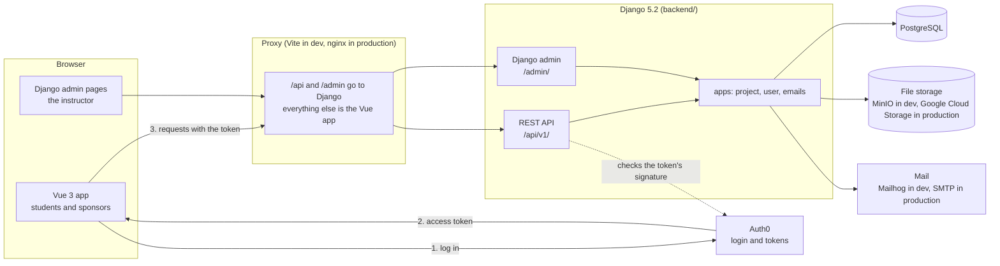
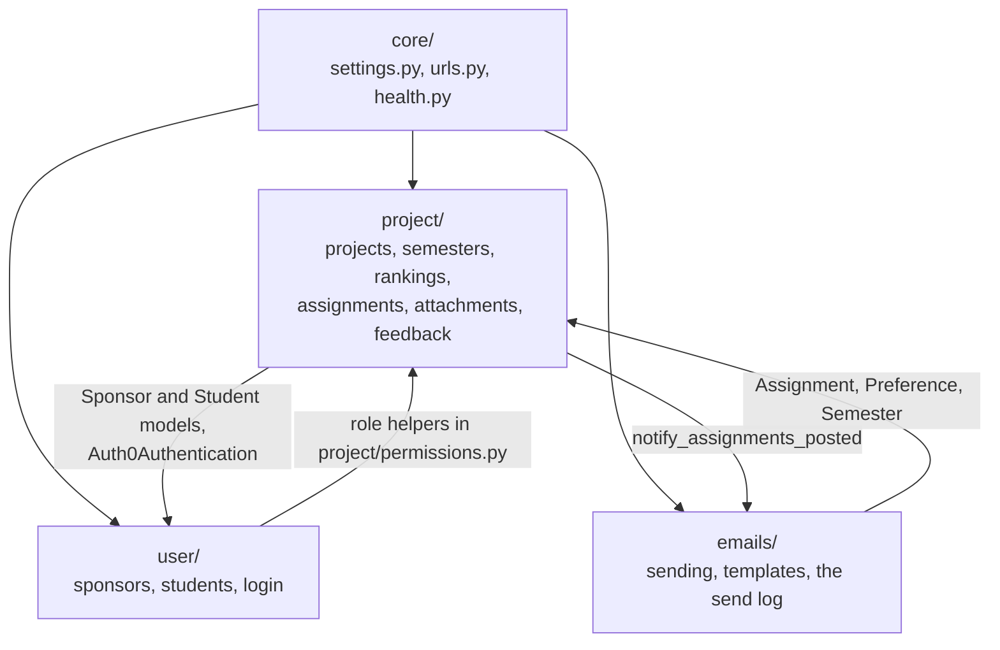
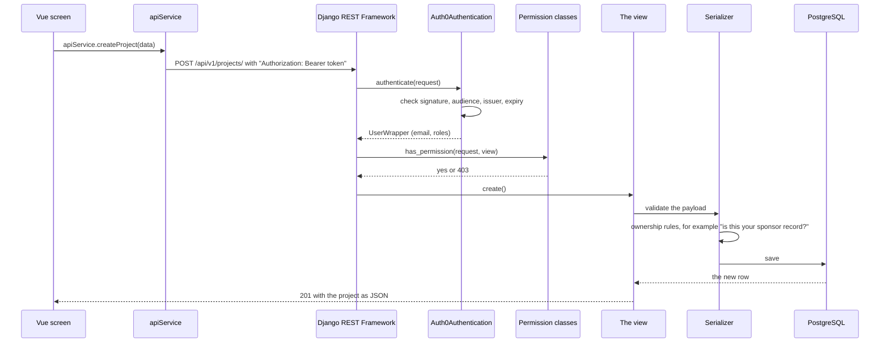
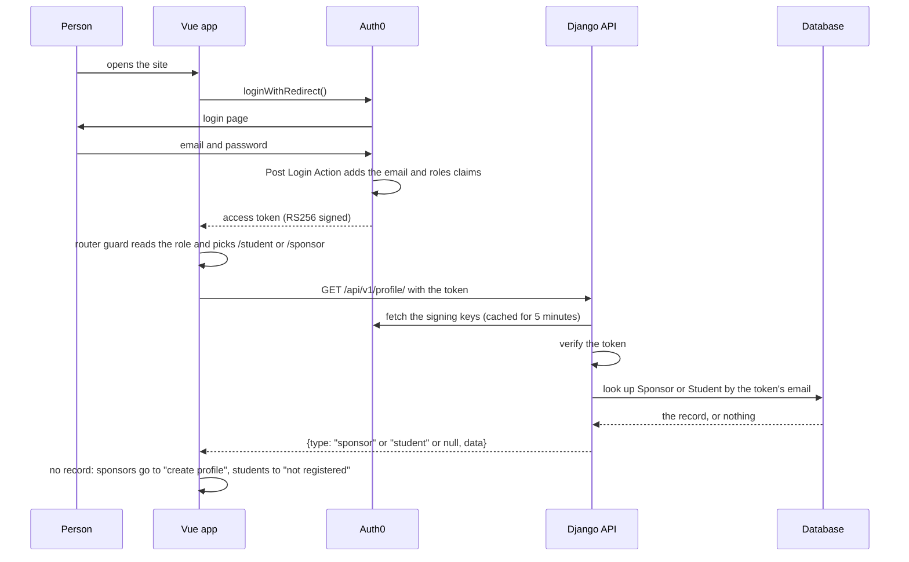
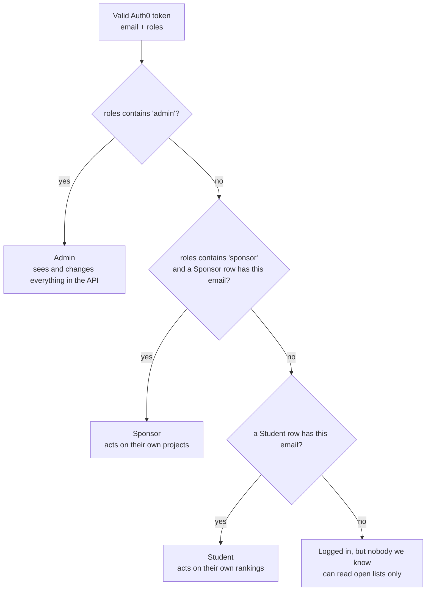
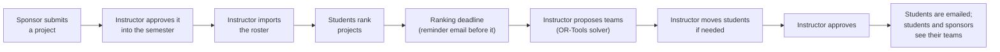
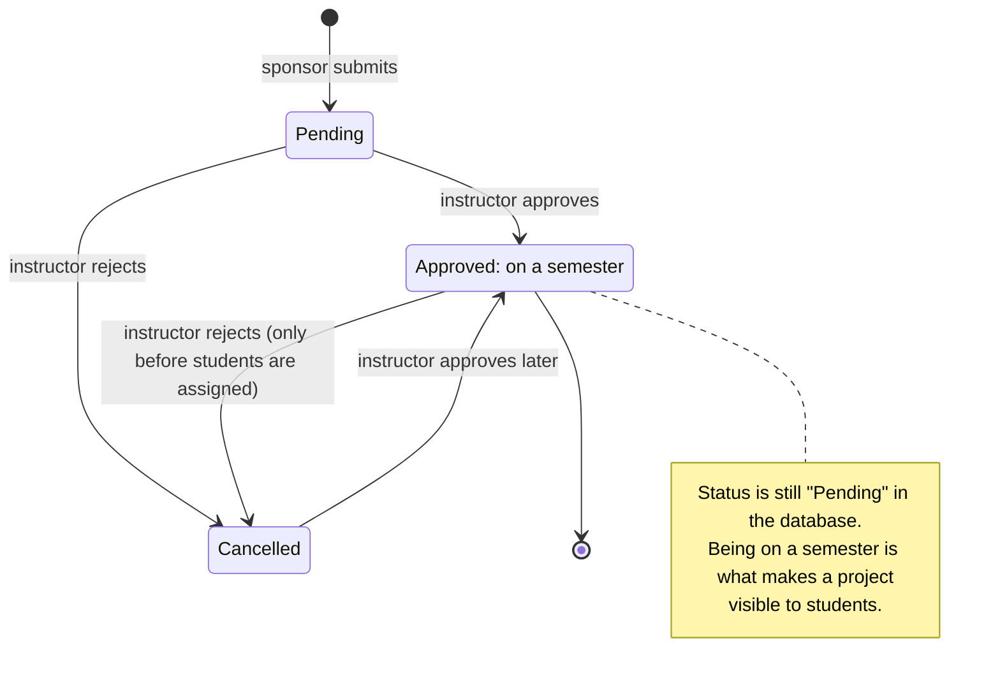

# Architecture

**Audience:** developers joining the project. How the code is organized, how a request travels through it, and how the app knows who is a student, a sponsor, or an admin.

This page describes the code on `main` as of 2026-11-20. For running it locally, see the [setup guide](README.md). For why the stack and the login approach were chosen, see [ADR-001](../decisions/ADR-001-stack.md) and [ADR-002](../decisions/ADR-002-auth.md).

## The system in one picture



There are two front doors, and they are used by different people:

| Front door | Who uses it | Login | Where the code is |
|---|---|---|---|
| The Vue app, at `/` | Students and sponsors | Auth0 | `frontend/src/` |
| Django admin, at `/admin/` | The instructor | A Django staff account (not Auth0) | `backend/*/admin.py` and `backend/templates/admin/` |

Both end up in the same Django apps and the same database. The instructor's tools (reviewing projects, importing the roster, proposing and approving teams, sending sponsor emails) are Django admin pages and actions. Nothing for the instructor is built in Vue.

## Backend: three Django apps

All backend code is in `backend/`. `core/` holds the project settings and the root URL file. The features are in three apps.



### `project/`: the semester's work

| File | What is in it |
|---|---|
| `models.py` | `Project`, `Semester`, `Preference` (a ranking), `Assignment`, `Attachment`, `Feedback`. See the [data model](data-model.md). |
| `views.py` | The API: `ProjectViewSet`, `SemesterViewSet`, `PreferenceAPIView`, `AssignmentViewSet`, `AttachmentViewSet`, `AttachmentDownloadAPIView`, `FeedbackViewSet`. |
| `serializers.py` | One serializer per model, plus the ownership rules that depend on the payload (which sponsor a project names, the project limit). |
| `permissions.py` | Who may do what: the role helpers and every permission class. Read this file first. |
| `review.py` | Approving and rejecting submitted projects. |
| `assignment.py` | The OR-Tools solver: propose teams, move students, approve. |
| `admin.py` | The instructor's pages for all of the above, including the proposal page. |
| `storage.py` | The MinIO storage class used in development. |
| `resources.py` | Import and export definitions for the admin. |
| `management/commands/seed_demo.py` | Loads demo sponsors, projects, students and rankings into a local database. |

### `user/`: people and login

| File | What is in it |
|---|---|
| `models.py` | `Sponsor` and `Student`. There is no user table; see "Who is who" below. |
| `authentication.py` | `Auth0Authentication` checks the token on every API request and builds a `UserWrapper`. |
| `views.py` | `SponsorViewSet`, `StudentViewSet`, and `profile_view` (`/api/v1/profile/`). |
| `resources.py` | `StudentResource`: the Blackboard roster import. |
| `admin.py` | Sponsor and student admin pages, the roster import screen, and the sponsor email actions. |

### `emails/`: everything that sends mail

| File | What is in it |
|---|---|
| `utils.py` | `EmailClient`: the one class that sends mail. Every send goes through it and is logged. |
| `notifications.py` | Student emails: "your assignment is posted" and the ranking-deadline reminder, with a guard against emailing real students by accident. |
| `models.py` | `EmailLog`: one row per send attempt. |
| `views.py` | Three admin-only API endpoints for sending mail. |
| `templates/emails/` | The HTML email templates. |
| `management/commands/send_deadline_reminders.py` | The reminder command, meant to run daily. |

### The API surface

Everything is under `/api/v1/` (`backend/core/urls.py`). Routes are registered in each app's `urls.py`.

| Route | View | Notes |
|---|---|---|
| `projects/` | `ProjectViewSet` | The list returns only the current semester's projects. Extra actions: `pending/`, `<id>/approve/`, `<id>/reject/`. |
| `semesters/` | `SemesterViewSet` | `semesters/current` returns the semester for today's date. |
| `preferences/` | `PreferenceAPIView` | A student's rankings. Accepts one object or a list. |
| `assignments/` | `AssignmentViewSet` | Who is on which project. |
| `attachments/` | `AttachmentViewSet` | Files and links on a project. `attachments/<id>/download/` serves the file. |
| `feedback/` | `FeedbackViewSet` | Sponsor feedback. |
| `sponsors/`, `students/` | `SponsorViewSet`, `StudentViewSet` | `sponsors/<id>/projects/` lists one sponsor's projects. |
| `profile/` | `profile_view` | The logged-in person's own sponsor or student record. |
| `emails/send`, `emails/sponsor-outreach`, `emails/project-presentation` | `emails/views.py` | Admin only. |
| `health/` | `core/health.py` | Used by the deployment to check the app and database. |

## Frontend: the Vue app

The frontend is a Vue 3 single-page app built with Vite, in `frontend/src/`.

| Path | What is in it |
|---|---|
| `main.js` | Creates the app and wires in Auth0, the router, Pinia and FormKit. |
| `router/index.js` | Every route, and the guard that decides who may open it. |
| `services/api.js` | `apiService`: the one place that talks to the backend. |
| `services/teams.js` | Groups assignments into teams for the sponsor dashboard. |
| `stores/` | Pinia stores: `projectsStore` (the project list) and `studentStore` (the student's profile, rankings and assignment). |
| `components/` | One file per screen or reusable piece, each with its test next to it (`Name.test.js`). |
| `App.vue`, `style.css` | The page shell with the sidebar, and global styles. |

### The screens

| Route | Component | For |
|---|---|---|
| `/` | `Login.vue` | everyone |
| `/student` | `StudentLanding.vue` | students |
| `/student/projects` | `StudentProjectView.vue` (uses `StudentProjectCard`, `ProjectDetailsSidebar`) | students |
| `/student/submit` | `StudentRankForm.vue` | students |
| `/student/assignment` | `StudentAssignment.vue` (uses `StudentAssignmentCard`) | students |
| `/sponsor` | `SponsorLanding.vue` (uses `SponsorProjectCard`, `ProjectAttachments`) | sponsors |
| `/sponsor/submit`, `/sponsor/edit` | `SponsorProjectForm.vue`, `SponsorEditProjectForm.vue` | sponsors |
| `/sponsor/feedback` | `SponsorFeedbackForm.vue` | sponsors |
| `/profile/create`, `/profile/edit` | `ProfileCreate.vue`, `ProfileEdit.vue` (both use `ProfileForm`) | sponsors |
| `/error/student-not-registered` | `StudentNotRegistered.vue` | a student who is not on the roster |

### How a screen calls the API

Every screen follows the same three steps: get the Auth0 token, hand it to `apiService`, call a method.

```js
const token = await getAccessTokenSilently();   // from useAuth0()
apiService.setToken(token);                      // sets the Authorization header
const projects = await apiService.getProjectsBySponsor(sponsorId);
```

`apiService` sends requests to `/api/v1/...` on the same origin. In development, Vite forwards `/api` to the backend container (`frontend/vite.config.js`). In production, nginx does the same (`frontend/nginx.conf`). The browser never needs the backend's address, and there is no CORS setup to maintain for the app itself.

## What happens on one API request



For a request on one object (`GET`, `PATCH` or `DELETE` on `/projects/7/`), two more things happen before the view runs:

1. `get_queryset()` narrows the rows this person may see at all. If the object is not in it, the answer is 404.
2. `has_object_permission()` decides whether they may do this to it. If not, the answer is 403.

The [conventions page](conventions.md) explains how to use each layer.

## Who is who: login and roles

Auth0 handles passwords and issues tokens. Our code never sees a password. A token carries two custom claims, set by an Auth0 Action ([Auth0 setup](auth0-setup.md)):

- `https://backend-api-capstone/email`
- `https://backend-api-capstone/roles`, for example `["sponsor"]`



There is no user table in our database. On every request the backend works out who the person is from the token and two lookups:



The helpers that make these decisions are all in `backend/project/permissions.py`:

| Helper | Answers |
|---|---|
| `is_admin(user)` | Does the token carry the admin role? |
| `user_has_role(user, 'sponsor')` | Does the token carry this role? |
| `sponsor_for_user(user)` | The `Sponsor` row matching the token's email, or `None`. |
| `student_for_user(user)` | The `Student` row matching the token's email, or `None`. |
| `owns_student_id(user, id)` | Is this person an admin, or the student with this id? |

Two points are easy to miss:

- **A student is whoever is on the roster.** The backend does not trust a "student" role claim to grant anything. It looks for a `Student` row with the token's email, and that row exists only because the instructor imported it ([roster import](flows.md#3-importing-the-roster-from-blackboard)). The frontend still reads the role claim, but only to choose which screens to show.
- **The instructor's Django admin login is separate.** It is a Django staff account with Django permissions, not an Auth0 token. An Auth0 "admin" role gives full access to the API; it does not log anyone in to `/admin/`.

### Who may do what

| Resource | Student | Sponsor | Admin | Rule lives in |
|---|---|---|---|---|
| Projects | Read the current semester's projects | Read; create, edit and delete their own, up to their project limit | Everything, including approve and reject | `ProjectWritePermission`, `ProjectSerializer`, `review.py` |
| Rejected (Cancelled) projects and their files | Hidden | Only their own | Visible | `hide_rejected_projects` |
| Rankings | Their own, until the deadline | None | All | `PreferenceAPIView` |
| Assignments | Their own and their teammates' | Those on their projects | Read and write all | `AssignmentViewSet.get_queryset`, `AdminWriteOrReadOnly` |
| Attachments | Read and download | Read; add and remove on their own projects | Everything | `AttachmentWritePermission` |
| Feedback | None | Their own | All | `SponsorFeedbackPermission` |
| Semesters | Read | Read | Read and write | `AdminWriteOrReadOnly` |
| Sponsor and student records | Read | Read | Read and write | `AdminWriteOrReadOnly` |
| Sending email through the API | No | No | Yes | `IsAdminRole` |

## A semester from start to finish

This is the order things happen in. Each step links to its walkthrough on the [main flows](flows.md) page.



A project's status changes along the way:



## Settings and services

Settings are read from environment variables in `backend/core/settings.py`. The variables and their local values are in `.env.example` and described in the [setup guide](README.md#create-your-local-environment-files).

| Concern | Development | Production |
|---|---|---|
| Database | PostgreSQL container | PostgreSQL container with a volume |
| Uploaded files | MinIO container | Google Cloud Storage when `GS_BUCKET_NAME` is set |
| Email | Mailhog container (catches everything) | The SMTP host in `EMAIL_HOST` |
| Web server | Vite dev server and Django `runserver` | nginx and gunicorn |
| Tests | Run inside the containers; CI uses SQLite | not applicable |

Deployment is covered in the [deployment guide](../deployment-guide/README.md).

## Known gaps

These are the things a new developer should know are not finished. Each has an Issue.

- Roles still come from the Auth0 token. Moving them into our database is #77 ([ADR-002](../decisions/ADR-002-auth.md) describes the target).
- Any logged-in person can read the sponsor and student lists. Writes are admin only.
- No full-semester end-to-end test exists yet (#80).
- A project's status does not change when a team is approved (#74).
- The ranking rule, team size and teammate requests are not confirmed by the sponsor (#81).

## Where to go next

- [Main flows](flows.md): each feature, step by step, with the files involved.
- [Adding a feature](adding-a-feature.md): a worked example from model to tests.
- [Conventions](conventions.md): permissions, scoping, tests.
- [Data model](data-model.md), [Auth0 setup](auth0-setup.md), [security notes](../security/README.md), [testing](../testing/README.md).
