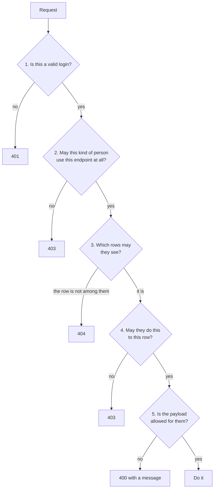
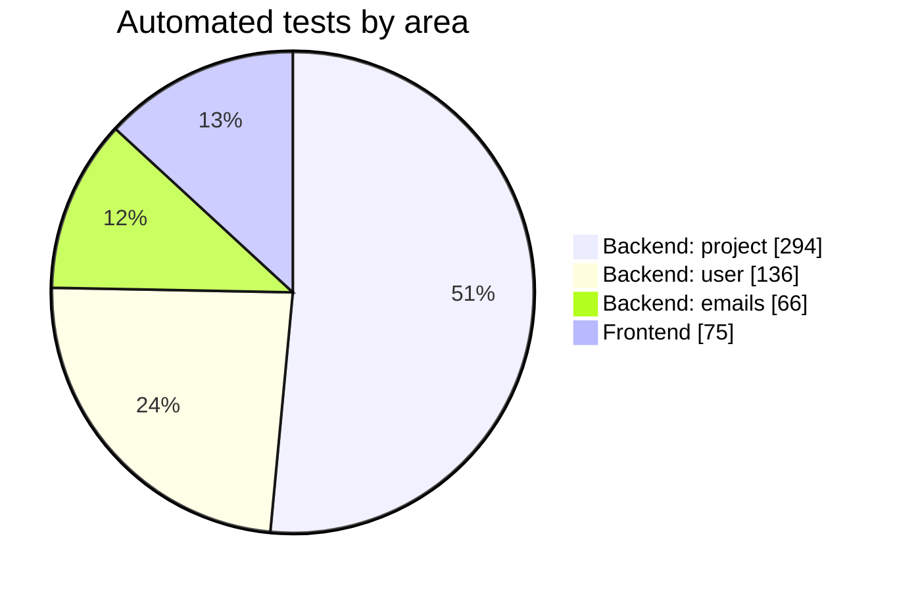

# Conventions

**Audience:** developers. The patterns the code follows, so new code looks and behaves like the rest. Each rule names a place in the code that shows it.

This page describes `main` as of 2026-11-20. For Git branches and pull requests, see the [setup guide](README.md#start-your-work-on-a-branch).

## Permissions and scoping on the API

Every API view answers three questions, in this order. Each has its own place in the code.



| Question | Where it goes | Example to copy |
|---|---|---|
| 1. Valid login? | `authentication_classes = [Auth0Authentication]` and `IsAuthenticated` on every view | any viewset in `project/views.py` |
| 2. May this kind of person use the endpoint? | `has_permission` in a permission class | `IsAdminRole`, `AdminWriteOrReadOnly` |
| 3. Which rows may they see? | `get_queryset()` on the view | `AssignmentViewSet.get_queryset`, `FeedbackViewSet.get_queryset` |
| 4. May they do this to this row? | `has_object_permission` in a permission class | `ProjectWritePermission`, `AttachmentWritePermission` |
| 5. Is the payload allowed? | `validate` in the serializer | `ProjectSerializer.validate_sponsor`, `AttachmentSerializer.validate` |

The rules:

1. **Every view sets both** `authentication_classes = [Auth0Authentication]` and `permission_classes` starting with `IsAuthenticated`. No view relies on a project-wide default.
2. **Scope rows in `get_queryset()`, not in the template or the frontend.** If a student should see only their own rankings, the queryset returns only those. A list endpoint then cannot leak, whatever filters the client sends.
3. **Not visible means 404. Visible but not allowed means 403.** A student asking for another student's ranking gets 404, so ids are not confirmed to exist (`PreferenceAPIView.get`).
4. **Use the role helpers in `project/permissions.py`**: `is_admin`, `user_has_role`, `sponsor_for_user`, `student_for_user`, `owns_student_id`. Do not read `request.user.roles` or compare emails in a view.
5. **A student is someone on the roster.** Use `student_for_user(user)`. Never grant student access because a token says "student".
6. **Ownership on create goes in the serializer.** `has_object_permission` does not run on create, because there is no object yet. That is why `ProjectSerializer` checks the sponsor in the payload and `AttachmentSerializer` checks the project.
7. **One rule, one helper.** Rejected projects are hidden by `hide_rejected_projects(queryset, user, project_path)`, used by the project list, the sponsor's project list, and attachments. If a rule applies in two places, write it once and call it.
8. **With `fields = '__all__'`, decide for every new field who may write it.** See [step 2 of adding a feature](adding-a-feature.md#2-the-serializer).
9. **Errors are `{'error': 'a sentence a person can act on'}`** with the right status code. Serializer errors use DRF's own format, keyed by field.
10. **Every permission rule has a test for "yes" and a test for each "no".**

Security background and the checks done so far are in the [security folder](../security/README.md).

## Where logic goes

| Kind of code | Where | Why |
|---|---|---|
| A rule about who may do something | `project/permissions.py` | One file to read to understand access |
| A multi-step operation (review a project, propose teams, send notifications) | Its own module: `project/review.py`, `project/assignment.py`, `emails/notifications.py` | The API view and the Django admin action both call it, so they cannot drift apart |
| Checking a payload | The serializer | Runs for create and update, with field-level error messages |
| A rule that must hold however a row is saved | The model (`clean`, validators, constraints) | Applies to the admin, imports and scripts too |
| HTTP details (status codes, parsing the request) | The view | Keep it thin |

Two patterns to know before changing them:

- **Service modules raise their own error with a message for the user**: `ProposalError`, `ReviewError`, `NotificationError`. Views and admin actions catch it and show the message. A bad setting produces a message, not a server error.
- **Proposals are not stored.** The assignment proposal travels as a signed token ([why](flows.md#why-there-is-a-token)). Do not add a table for it without reading that section.

`Model.clean()` runs in forms and the Django admin, not when the API saves. If a rule matters for the API, check it in the serializer too (`SemesterSerializer.validate` repeats `Semester.clean`).

## Django admin

The instructor's tools are Django admin pages. When you add one:

- **Actions that change data need a permission**: `@admin.action(permissions=['change'])` or `@action_with_form(..., permissions=['change'])`. Without it, any staff account that can open the list can run the action.
- **Custom admin views check permissions themselves.** `SemesterAdmin.can_assign` is used by the propose action and by both proposal views.
- **Actions that need input use `django-admin-action-forms`** (`AdminActionForm`). `ProjectAdmin.ApproveProjectsActionForm` is a short example.
- **Custom pages extend `admin/base_site.html`** and live in `backend/templates/admin/<app>/<model>/`.

## Frontend

- **All backend calls go through `apiService`** in `services/api.js`. Components do not import `axios`.
- **Every screen sets the token before calling**: `getAccessTokenSilently()`, then `apiService.setToken(token)`.
- **Route access is `meta: { roles: [...] }`** in `router/index.js`. It controls what is shown, not what is allowed. The API enforces access.
- **Shared state goes in a Pinia store** (`stores/`). State used by one screen stays in that component.
- **Reshaping data for display is a pure function** in `services/` (see `teams.js`), so it has a plain unit test.
- **Forms use FormKit.** Show server errors next to the field; `describeError()` in `SponsorProjectForm.vue` turns the API's error format into text.
- **Never render uploaded or user-entered content as HTML.** Links are only clickable when they are plain `http(s)` (`ProjectAttachments.vue`).

## Tests

### Layout

```
backend/
  project/tests/     test_models.py  test_serializers.py  test_views.py  test_admin.py
                     test_assignment.py  test_review.py  test_endpoint_permissions_security.py
  user/tests/        test_models.py  test_serializers.py  test_views.py  test_admin.py
                     test_resources.py  test_authentication_security.py  test_record_security.py
  emails/tests/      test_serializers.py  test_views.py  test_utils.py  test_notifications.py
frontend/src/
  components/Name.vue  +  components/Name.test.js     (the test sits next to the file)
  services/api.js      +  services/api.test.js
  stores/xStore.js     +  stores/xStore.test.js
  router/index.js      +  router/index.test.js
```

A backend test file is named for what it tests: the layer (`test_models`, `test_views`) or the feature (`test_assignment`, `test_review`). A feature with its own module gets its own test file.

### Where the tests are

571 automated tests as of 2026-11-21: 496 backend and 75 frontend.



| Largest backend test files | Tests | What they cover |
|---|---|---|
| `project/tests/test_assignment.py` | 79 | The solver, moving students, approval, team sizes, the fairness limit and the comparison |
| `project/tests/test_views.py` | 79 | The project API for each role |
| `project/tests/test_models.py` | 52 | Model rules, including attachments |
| `user/tests/test_resources.py` | 42 | The Blackboard roster import |
| `user/tests/test_models.py` | 37 | Sponsor and student validation |
| `project/tests/test_review.py` | 32 | Approving and rejecting projects |

### Writing backend tests

- **Log in with `make_client(email, roles)`** from `project/tests/test_views.py`. It authenticates as that person without a real Auth0 token.
- **Build data with fixtures at the top of the file.** Use `example.com` emails and 8-digit CWIDs.
- **Create "the current semester" from today's date** when a test touches the project list or rankings:
  `Semester.objects.create(semester=Semester.get_semester_by_date(now), year=now.year, assignment_date=now)`.
- **Name a test for the behaviour**: `test_reject_hides_the_project_from_students`, not `test_reject_2`.
- **Assert that nothing was written** when testing a refusal: check the row count or re-read the row.
- **Admin pages are tested through Django's test client** (`admin_client`), which exercises the real form and template. `TestSemesterAdminFlow` in `test_assignment.py` shows how.
- **Mail goes to Django's in-memory outbox** in tests (`django.core.mail.outbox`). No test sends real email.

### Writing frontend tests

- Use `vitest` with `@vue/test-utils`. `mount` or `shallowMount` the component and assert on what is rendered.
- Mock `apiService` and `@auth0/auth0-vue` for a component that loads data. `ProjectAttachments.test.js` is the fullest example.
- FormKit validates after a short delay. `SponsorProjectForm.test.js` has a `settle()` helper that waits for it.

### Running tests

The stack must be running. From the repository root:

| What | Command |
|---|---|
| Both suites, as CI does | `scripts/test.sh` (PowerShell: `.\scripts\test.ps1`) |
| Backend only | `scripts/test.sh backend` |
| Frontend only | `scripts/test.sh frontend` |
| One backend file | `docker compose -f docker-compose.dev.yml exec backend pytest project/tests/test_review.py -q` |
| Backend tests matching a word | `docker compose -f docker-compose.dev.yml exec backend pytest -k reject -q` |
| One frontend file | `docker compose -f docker-compose.dev.yml exec frontend npx vitest run src/services/api.test.js` |
| Check migrations are complete | `docker compose -f docker-compose.dev.yml exec backend python manage.py makemigrations --check --dry-run` |

CI (`.github/workflows/test.yml`) runs both suites on every push and pull request. A pull request should not merge with a red check. The [testing page](../testing/README.md) has more, including running without Docker and known gaps.

## Migrations and models

- **Name migrations**: `makemigrations <app> -n what_it_does`.
- **New columns have a default or allow blank.**
- **Do not edit a migration that is on `main`.** If your number clashes with one merged while you worked, delete yours and regenerate.
- **Document each model field** with the docstring style used in `models.py`: `[Required]`, `[Optional]`, `[Default]` or `[Calculated]`, then a sentence.
- **Update the [data model page](data-model.md)** when you add a table or column.

## Style

- Python follows the surrounding file: 4 spaces, single quotes, lines up to about 120 characters.
- Comments say why, not what. A reference to the Issue helps: `# Team sizes come from the semester (#68)`.
- Messages a user will read are full sentences that say what to do next: "No assignment puts 5 students into teams of 4. Lower the minimum team size or change the team size."
- Pin new backend packages to an exact version in `backend/requirements.txt`.

## Documentation

When code changes, the page that describes it changes in the same pull request.

| You changed | Update |
|---|---|
| An endpoint or its rules | `backend/README.md` |
| A table or column | [data-model.md](data-model.md) |
| How a feature works | [flows.md](flows.md) |
| What a user sees or does | [user guide](../user-guide/README.md) |
| A decision with lasting consequences | a new ADR in [decisions](../decisions/README.md) |
| Something you looked into and compared options for | a page in [investigations](../investigations/) |
| How to deploy or operate it | [deployment guide](../deployment-guide/README.md) |
