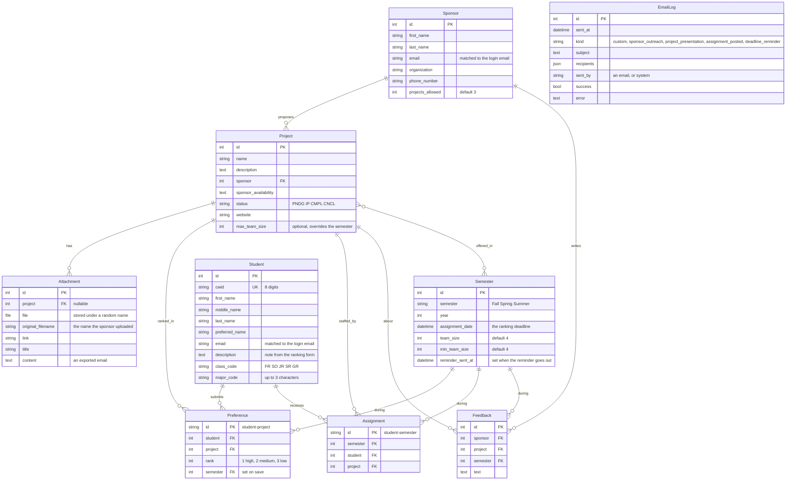

# Data Model

**Audience:** developers. The database as it is on `main`, what each table is for, and the rules the database and the models enforce.

As of 2026-11-21. The source of truth is `backend/user/models.py`, `backend/project/models.py`, and `backend/emails/models.py`; update the diagram when those change. For how the tables are used by each feature, see [main flows](flows.md).

## The schema

Every table except `EmailLog` and `Attachment` also has `created_at` and `updated_at`; `Attachment` has `created_at` only. `EmailLog` stands alone on purpose: it records who was emailed even after the people or projects are deleted.

## What each table is for

| Table | One row is | Written by |
|---|---|---|
| `Sponsor` | A person who proposes projects | The sponsor's own profile form; the instructor |
| `Student` | A student on the class roster. **Being in this table is what makes someone a student** | Only the instructor's roster import or the admin |
| `Project` | A proposed project and its review status | The sponsor; the instructor approves or rejects |
| `Semester` | One offering of the course, with its ranking deadline and team sizes | The instructor |
| `Preference` | One student's ranking of one project | The student, until the deadline |
| `Assignment` | One student placed on one project for one semester | Created when the instructor approves a proposal |
| `Attachment` | A file or link on a project, or an exported email | The owning sponsor; the instructor |
| `Feedback` | A sponsor's comment on their project for a semester | The sponsor |
| `EmailLog` | One email the site sent, with its recipients and whether it succeeded | The system. Read-only in admin |

A **team** is not a table. It is every `Assignment` with the same project and semester.

## Rules that are enforced

| Rule | Where |
|---|---|
| A student has one CWID, eight digits, unique | Database constraint and validator on `Student.cwid` |
| A sponsor cannot have two projects with the same name | Database constraint `unique_name_sponsor` |
| One `Semester` per term and year | Database constraint `unique_semester_year` |
| A student ranks a project once | `Preference`'s primary key is `<student id>-<project id>` |
| A student has one project per semester | `Assignment`'s primary key is `<student id>-<semester id>`, so approving again replaces the row |
| The minimum team size cannot exceed the team size | `Semester.clean` and the serializer |
| An attachment is a file or a link, not both, unless it is an exported email | `Attachment.clean`, run on every save |
| Uploads are one of seven file types and at most 25 MB | Validators on `Attachment.file` |
| A sponsor with projects cannot be deleted | `Project.sponsor` uses `on_delete=PROTECT` |
| Deleting a project, student, or semester removes its rankings, assignments, attachments and feedback | `on_delete=CASCADE` on those foreign keys |
| Rankings cannot change after the deadline | The preferences endpoint compares the time with `Semester.assignment_date` |
| Deleting an attachment deletes its file from storage | `Attachment.delete` |

## What is not in the database

| Thing | Where it lives instead | Why |
|---|---|---|
| Passwords and logins for students and sponsors | Auth0 | [ADR-002](../decisions/ADR-002-auth.md) |
| Roles | The Auth0 token (`admin`, `sponsor`), and the roster for students | [Architecture](architecture.md) |
| The instructor's account | Django's own `auth_user` table, as a staff user | The instructor works in Django admin |
| A proposed assignment before it is approved | A signed token in the proposal page, valid for one hour | [ADR-004](../decisions/ADR-004-assignment-solver.md) |
| Uploaded files | MinIO in development, Google Cloud Storage in production. The database holds only the path | [ADR-005](../decisions/ADR-005-file-storage.md) |
| Email bodies | Nowhere. `EmailLog` keeps the subject and recipients only | |

## Things to know before changing it

- **Emails are not unique.** `Sponsor.email` and `Student.email` have no uniqueness constraint, and the code looks a person up by email (`sponsor_for_user`, `student_for_user` in `backend/project/permissions.py`). The roster import refuses an email that already belongs to another CWID; the sponsor profile endpoint refuses a second profile for the same login.
- **The roster is not per semester.** `Student` has no link to `Semester` until the student ranks. An import adds and updates students and never removes them.
- **`Preference.semester` is filled in on save** from the date, using the current term and year. A ranking saved when no matching `Semester` exists has no semester.
- **`Project.status` is set by people**, except that approving and rejecting change it. It does not follow assignments (#74).
- **Two tables key on a text slug**, not a number: `Preference` and `Assignment`. Use the model's `generate_id` rather than building the key by hand.
- **Every schema change needs a migration** in the same pull request, with a test. See [adding a feature](adding-a-feature.md) and [conventions](conventions.md#migrations-and-models).

## How it got here

The schema was inherited from the previous team ([v1 reference](../investigations/v1-reference.md)). This team added:

| Change | Issue | Migration |
|---|---|---|
| `Semester.reminder_sent_at` | #54 | `project` 0022 |
| `Attachment` no longer hard-wires a storage backend | #72 | `project` 0023 |
| `Attachment.original_filename`, with files stored under random names | #72 | `project` 0024 |
| `Semester.team_size`, `Semester.min_team_size`, `Project.max_team_size` | #68 | `project` 0025 |
| `EmailLog` | #73 | `emails` 0001 |

Considered and not built: a separate user table with a role column ([ADR-002](../decisions/ADR-002-auth.md) describes it; roles stayed in the token), a `Team` table (teams are derived from assignments), and uniqueness on project names within a semester (#79). The [recommendations](../recommendations/README.md) page lists what we would change next.

## Scale assumptions

Under 100 users per semester, with one traffic spike when rankings are due. No scaling work has been done or is needed at that size. Correctness comes from database constraints and server-side checks, not from application-level locking.
