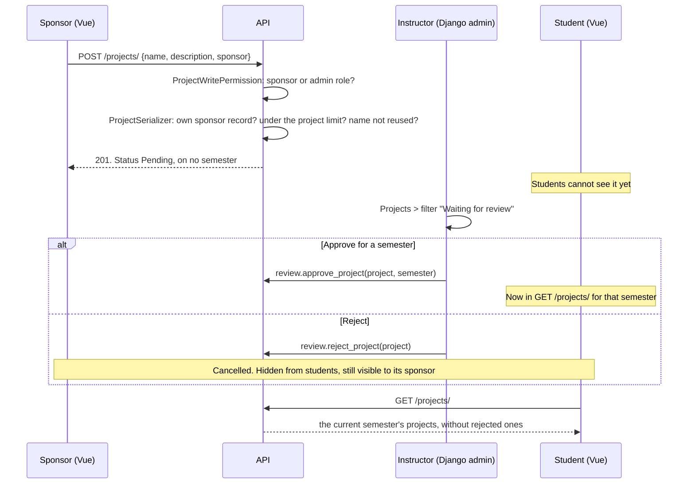
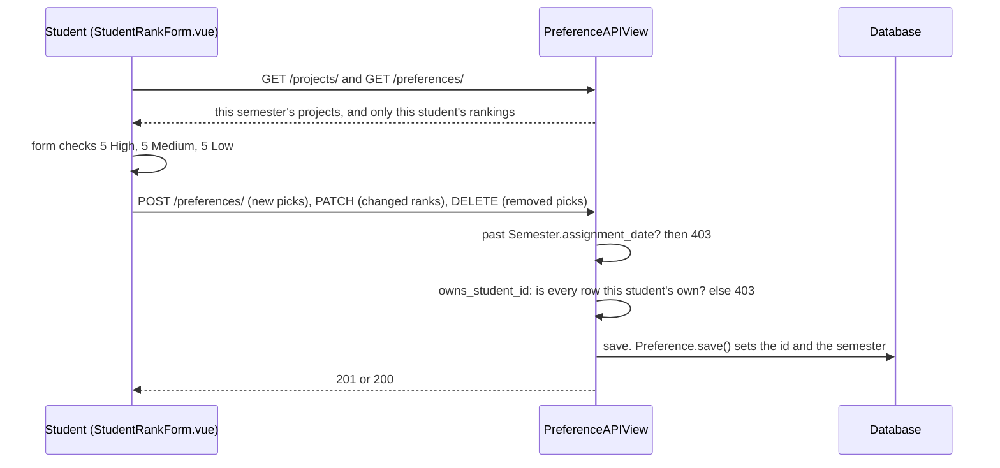
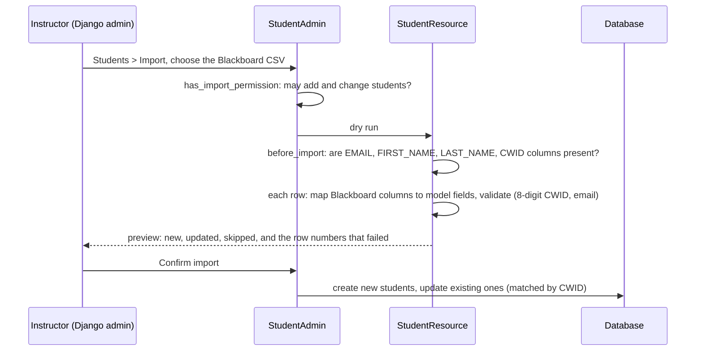
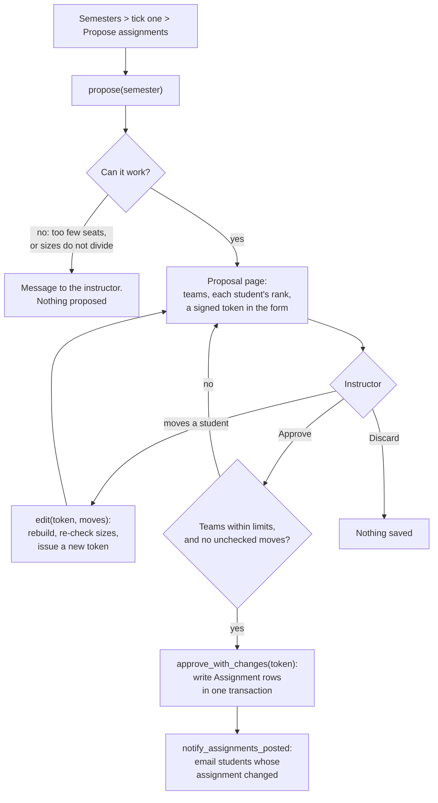
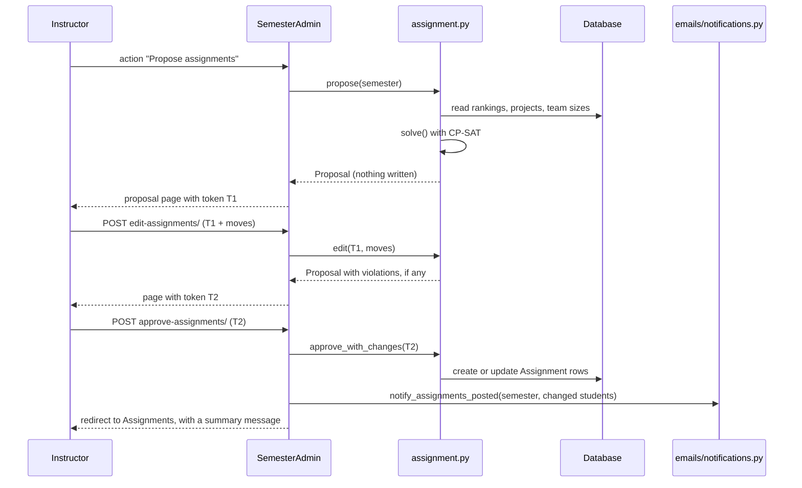
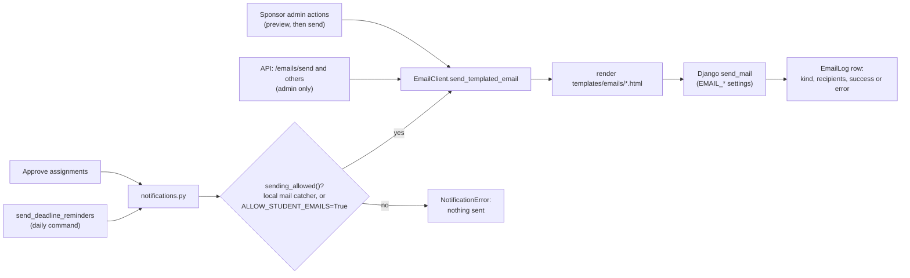
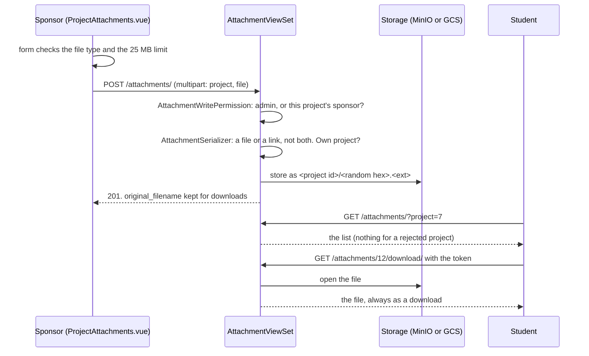

# Main Flows

**Audience:** developers. Each feature of the app, step by step, with the files that do the work and the tests that cover it.

Read the [architecture page](architecture.md) first for the overall layout. This page describes `main` as of 2026-11-20. File paths are relative to the repository root.

| # | Flow | Who starts it | Where it runs |
|---|---|---|---|
| 1 | [Submitting and reviewing a project](#1-submitting-and-reviewing-a-project) | Sponsor, then instructor | Vue app, then Django admin |
| 2 | [Ranking projects](#2-ranking-projects) | Student | Vue app |
| 3 | [Importing the roster from Blackboard](#3-importing-the-roster-from-blackboard) | Instructor | Django admin |
| 4 | [Proposing and approving assignments](#4-proposing-and-approving-assignments) | Instructor | Django admin |
| 5 | [Emails](#5-emails) | The system, or the instructor | Backend |
| 6 | [File attachments](#6-file-attachments) | Sponsor | Vue app |

---

## 1. Submitting and reviewing a project

A sponsor submits a project. It stays hidden from students until the instructor approves it into a semester.

| Step | Files |
|---|---|
| The form | `frontend/src/components/SponsorProjectForm.vue` (create), `SponsorEditProjectForm.vue` (edit). Server errors are shown inline by `describeError()`. |
| The API call | `apiService.createProject`, `putProject` in `frontend/src/services/api.js` |
| Who may write | `ProjectWritePermission` in `backend/project/permissions.py` |
| Payload rules | `ProjectSerializer` in `backend/project/serializers.py`: `validate_sponsor`, the `projects_allowed` limit in `validate`, and the unique name per sponsor |
| Review logic | `backend/project/review.py`: `pending_projects`, `approve_project`, `reject_project` |
| Instructor screen | `ProjectAdmin` in `backend/project/admin.py`: the `ReviewFilter` and the `approve_projects` and `reject_projects` actions |
| Review API | `ProjectViewSet.pending`, `approve`, `reject` in `backend/project/views.py` (admin only) |
| What students see | `ProjectViewSet.list` (current semester only) and `get_queryset` (`hide_rejected_projects`) |
| Tests | `backend/project/tests/test_views.py` (`TestProjectWriteRules`), `test_review.py`, `frontend/src/components/SponsorProjectForm.test.js` |

Rules worth knowing:

- "Waiting for review" means status Pending and on no semester. Approving adds the project to a semester; it does not change the status.
- `status` is read-only in the project API, so nobody can change it by editing a project.
- A project cannot be rejected once students are assigned to it.
- A rejected project is hidden everywhere a student could find it: the project list and detail, `/sponsors/<id>/projects/`, and its attachments.

---

## 2. Ranking projects

A student picks 5 High, 5 Medium and 5 Low priority projects before the semester's deadline. Each pick is one `Preference` row with `rank` 1, 2 or 3.

| Step | Files |
|---|---|
| The form | `frontend/src/components/StudentRankForm.vue`. The 5/5/5 check is `counts` near the top of the script. |
| Student state | `frontend/src/stores/studentStore.js`: profile, rankings, `hasRanked`, `isDeadlinePast` |
| The API | `PreferenceAPIView` in `backend/project/views.py`: `get`, `post`, `patch`, `delete` |
| Deadline | `PreferenceAPIView.deadline_closed_response` compares now with `Semester.assignment_date` |
| Ownership | `visible_preferences` (reads) and `owns_student_id` (writes), from `permissions.py` |
| The model | `Preference` in `backend/project/models.py`. The primary key is the slug `<student id>-<project id>`, built in `generate_id`. |
| Tests | `backend/project/tests/test_views.py` (preference tests), `test_models.py`, `frontend/src/stores/studentStore.test.js` |

Rules worth knowing:

- A student who asks for another student's ranking gets 404, not 403, so ids are not confirmed to exist.
- The 5/5/5 rule is checked in the form only. The server enforces the deadline and ownership, not the count. The sponsor has not confirmed the rule (#81).
- `Preference.semester` is set from today's date when the row is saved, not sent by the client.

---

## 3. Importing the roster from Blackboard

The instructor uploads the class list. This is what makes someone a student: at login, the backend matches the token's email against the `Student` table ([who is who](architecture.md#who-is-who-login-and-roles)).

| Step | Files |
|---|---|
| Column mapping and validation | `StudentResource` in `backend/user/resources.py`. `REQUIRED_COLUMNS` lists what a roster must have; `import_id_fields = ('cwid',)` matches existing students. |
| The import screen | `StudentAdmin` in `backend/user/admin.py`: `has_import_permission`, `import_action`, `rows_with_problems` |
| The model | `Student` in `backend/user/models.py` |
| Why it works this way | [Blackboard CSV import investigation](../investigations/blackboard-csv-import.md) |
| Tests | `backend/user/tests/test_resources.py`, `test_admin.py` |

Rules worth knowing:

- The import is built on the `django-import-export` library, which provides the preview-then-confirm screens.
- A bad row is reported with its row number and the good rows still import.
- A missing optional column leaves that value unchanged on existing students instead of blanking it.
- Students are not linked to a semester. The "cohort" for assignment is whoever has rankings for that semester.

---

## 4. Proposing and approving assignments

After the deadline, the instructor has the solver propose teams, adjusts them if needed, and approves. Nothing is saved until approval. Background and the choice of solver: [OR-Tools evaluation](../investigations/or-tools-evaluation.md).

### What the solver does

`solve()` in `backend/project/assignment.py` builds a CP-SAT model:

| Part | Definition |
|---|---|
| Variables | One yes/no per student-project pair, plus one "this project has a team" per project |
| Each student | On exactly one project |
| Each project | No students, or between its fewest and its most (`team_limits`) |
| Goal | Lowest total cost: rank 1 costs 0, rank 2 costs 1, rank 3 costs 3, a project the student did not rank costs 10 (`RANK_COST`, `UNRANKED_COST`) |

Team sizes come from the semester (`Semester.team_size`, `min_team_size`), and a project can set its own maximum (`Project.max_team_size`).

**Fairness limit (optional).** By default the solver minimises the total cost, which can leave one student much worse off than the rest. When proposing, the instructor can pick a limit on the worst placement any student gets, for example "nobody below their second choice". `solve(..., max_rank=...)` then adds a penalty for every placement beyond the limit that is larger than anything the rankings can add up to, so the solver first keeps as many students as possible within the limit and only then optimises the rankings. If the limit cannot be met for everyone, it gets as close as it can and the proposal page says how many students are beyond it (`Proposal.worst_rank`, `Proposal.beyond_limit`).

**Comparing team sizes.** The **Compare team sizes** action runs the solver once per setting the instructor types (`4`, `3-4`, `3-5`) and shows the results side by side: whether each setting can work, how many teams form, how many students get each choice, and the worst placement. `compare(semester, settings, max_rank)` returns one `Comparison` per setting and saves nothing; each column has a button that opens the ordinary proposal page for that setting.

### Why there is a token

A proposal is never stored. The proposal page carries it in a hidden form field as a signed token (`django.core.signing`, one-hour expiry). The token holds the student-project pairs, the size limits, and the solver's original pairs. Each re-check issues a new token; approval verifies the signature and re-checks that every student and project still exists. This avoids a proposal table and a status column.

| Step | Files |
|---|---|
| Solver and proposal logic | `backend/project/assignment.py`: `solve`, `team_limits`, `beyond_limit`, `propose`, `compare`, `parse_settings`, `edit`, `pending_moves`, `approve`, `approve_with_changes`, and the `Proposal`, `Team` and `Comparison` dataclasses |
| Instructor screens | `SemesterAdmin` in `backend/project/admin.py`: the `propose_assignments` and `compare_team_sizes` actions, `propose_with_view`, `edit_assignments_view`, `approve_assignments_view`, `can_assign` |
| The pages | `backend/templates/admin/project/semester/assignment_proposal.html`, `team_size_comparison.html` |
| Team size settings | `Semester.team_size`, `Semester.min_team_size`, `Project.max_team_size` in `backend/project/models.py` |
| Who sees the result | `AssignmentViewSet.get_queryset` in `backend/project/views.py`: a student sees their team, a sponsor sees their projects' teams |
| Student screen | `frontend/src/components/StudentAssignment.vue`, `StudentAssignmentCard.vue` |
| Sponsor screen | `frontend/src/components/SponsorLanding.vue`, `SponsorProjectCard.vue`, `frontend/src/services/teams.js` |
| Tests | `backend/project/tests/test_assignment.py`, `frontend/src/components/StudentAssignmentCard.test.js`, `SponsorProjectCard.test.js`, `frontend/src/services/teams.test.js` |

Rules worth knowing:

- Proposing, re-checking and approving all need add and change permission on assignments (`SemesterAdmin.can_assign`).
- Only students with rankings for the semester are included. Cancelled projects are skipped.
- Approving replaces a student's existing assignment for that semester. `Assignment`'s primary key is `<student id>-<semester id>`, so a student has one project per semester.
- If Approve is posted with moves that were not re-checked, the page re-checks and shows them instead of saving.
- A mail failure never undoes an approval.

---

## 5. Emails

All mail goes through one class, `EmailClient` in `backend/emails/utils.py`, and every attempt is written to `EmailLog`.

| Email | Sent when | To | Code |
|---|---|---|---|
| Assignment posted | The instructor approves a proposal | Students whose assignment is new or changed | `notify_assignments_posted` in `emails/notifications.py`, called from `SemesterAdmin.approve_assignments_view` |
| Ranking deadline reminder | `manage.py send_deadline_reminders` runs within `DEADLINE_REMINDER_DAYS` of the deadline | Students with no rankings | `send_deadline_reminders` in `emails/notifications.py` and the command in `emails/management/commands/` |
| Sponsor outreach | The instructor runs "Send Sponsor Outreach Email" on selected sponsors | Those sponsors | `SponsorAdmin` in `backend/user/admin.py`, `EmailClient.send_sponsor_outreach` |
| Project presentation invite | The instructor runs "Send Project Presentation Email" | Those sponsors | `SponsorAdmin`, `EmailClient.send_project_presentation` |

| Step | Files |
|---|---|
| Sending and logging | `backend/emails/utils.py` (`EmailClient`), `backend/emails/models.py` (`EmailLog`) |
| Student emails and the safety guard | `backend/emails/notifications.py` |
| Templates | `backend/emails/templates/emails/` |
| Sponsor email screens | `backend/user/admin.py`, `backend/templates/admin/sponsor_outreach_action.html`, `project_presentation_action.html` |
| API endpoints | `backend/emails/views.py`, `backend/emails/urls.py` |
| Settings | `EMAIL_*`, `DEADLINE_REMINDER_DAYS`, `APP_URL`, `ALLOW_STUDENT_EMAILS`, `CAPSTONE_YEAR` in `backend/core/settings.py`; described in `backend/emails/README.md` |
| Choosing a mail provider | [Mailhog to SMTP investigation](../investigations/mailhog-to-smtp2go.md) |
| Tests | `backend/emails/tests/`, and the approve-flow tests in `backend/project/tests/test_assignment.py` |

Rules worth knowing:

- Student emails are refused unless mail goes to a local catcher (console, Mailhog) or `ALLOW_STUDENT_EMAILS=True`. This is what stops a test run from mailing a real class.
- SMTP credentials come from server settings only. `EmailClient` does not accept them as arguments.
- Locally, open Mailhog at http://localhost:8025 to read what was sent.
- Nothing schedules the reminder command yet. It needs a daily job on the server.

---

## 6. File attachments

A sponsor adds files or links to their project. Students can see and download them.

| Step | Files |
|---|---|
| The panel | `frontend/src/components/ProjectAttachments.vue`. Shown with edit controls in `SponsorProjectCard.vue`, read-only in `ProjectDetailsSidebar.vue`. |
| API calls | `getAttachments`, `uploadAttachment`, `addAttachmentLink`, `deleteAttachment`, `downloadAttachment` in `frontend/src/services/api.js` |
| The API | `AttachmentViewSet` and `AttachmentDownloadAPIView` in `backend/project/views.py` |
| Who may write | `AttachmentWritePermission` in `backend/project/permissions.py`, and the ownership check in `AttachmentSerializer` |
| File rules | `Attachment` in `backend/project/models.py`: `ALLOWED_ATTACHMENT_FILE_EXTENSIONS`, `MAX_ATTACHMENT_FILE_SIZE`, `attachment_upload_path`, `download_name` |
| Where files go | `STORAGES` in `backend/core/settings.py`; `backend/project/storage.py` for MinIO |
| Upload size at the proxy | `client_max_body_size 30m` in `frontend/nginx.conf` |
| Why it works this way | [File hosting investigation](../investigations/file-hosting.md), [attachment and feedback permissions](../security/attachment-feedback-permissions.md) |
| Tests | `backend/project/tests/test_endpoint_permissions_security.py`, `test_models.py`, `test_views.py`, `frontend/src/components/ProjectAttachments.test.js` |

Rules worth knowing:

- Allowed types are pdf, docx, pptx, png, jpeg, jpg and zip, up to 25 MB. The form and the server both check.
- The stored name is random, so two uploads never overwrite each other and the uploader's filename never becomes part of a path.
- Downloads need the bearer token, so the frontend fetches the file as a blob instead of using a plain link.
- Files are always served as a download, never rendered in the page.
- In production, files are kept only if `GS_BUCKET_NAME` is set. Otherwise they are written inside the container and lost on a rebuild.
