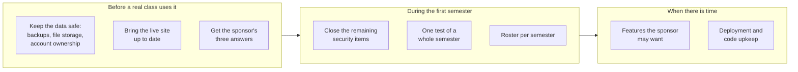

# Recommendations

**Audience:** the sponsor and the next team. What we would do next, in what order, and what we looked at and decided against.

Written 2026-11-20 against `main`. Every item names where it is tracked or where the evidence is, so nothing here has to be taken on trust. Effort is our estimate for one developer who already has the project running: **S** is a day or less, **M** is a few days, **L** is a week or more.

## The short version

If the next team does only five things, these are the five:

| # | Do this | Why first |
|---|---|---|
| 1 | Record who owns the Google Cloud project, the domain, the Auth0 tenant, and the sending email account, and move each to an account the instructor controls | Every one of them is tied to a student today. The previous team's site disappeared this way |
| 2 | Turn on a nightly database backup and configure the file storage bucket | Nothing backs up the database, and without a bucket every deployment deletes uploaded files |
| 3 | Redeploy the live site from `main` | It is running a build from 2026-10-27; none of Iteration 3 is on it |
| 4 | Ask the sponsor the three open questions | Ranking rule, team size, and teammate requests were first asked on 9/22 and shape the solver |
| 5 | Add one automated test of a full semester | The features were built and tested separately; nothing checks them end to end |

## 1. Before a real class uses the site

These are about not losing a semester's data. None needs new features.

| Recommendation | Why | Effort | Where |
|---|---|---|---|
| **Write down account ownership** and hand each account to the instructor: Google Cloud project and billing, DuckDNS, Auth0 tenant (invite her as tenant admin), the SMTP account | The site outlives the team only if the accounts do | S | [Deployment guide](../deployment-guide/README.md#what-only-the-vms-owner-can-confirm), [FAQ](../faq/README.md), #45 |
| **Back up the database every night**, and keep the copies off the VM | The repository has no backup of any kind. The commands are written and were tested | S | [Operations: back up the database](../deployment-guide/operations.md#back-up-the-database) |
| **Set `GS_BUCKET_NAME`** so uploads go to Google Cloud Storage | Otherwise sponsors' files live inside the container and are deleted on every deployment | S | [Configuration: uploaded files](../deployment-guide/configuration.md#uploaded-files) |
| **Redeploy from `main`** and switch the live site to the team's Auth0 tenant | The live site is three weeks behind and may still use the previous team's tenant | S | #58, [Operations: deploy a new version](../deployment-guide/operations.md#deploy-a-new-version) |
| **Have someone who did not write the deployment guide redeploy from it** | The guide was rehearsed on a laptop, not on the VM | S | #83 |
| **Schedule the deadline reminder** | It is a command that only runs if cron calls it | S | [Operations: deadline reminders](../deployment-guide/operations.md#deadline-reminders) |
| **Get a real Blackboard roster export** and import it on a test copy | The import was built from the column names alone. No real file has ever been through it | S | [Roster import investigation](../investigations/blackboard-csv-import.md) |
| **Get the sponsor's answers** on the ranking rule (5 high, 5 medium, 5 low is what is built), whether team size is always 4, and whether students may request or avoid teammates | The first two are built on our assumption. The third changes the data model and the solver | S to ask | #81 |

## 2. Security

The gaps we inherited are closed: every endpoint checks the user's role, students and sponsors reach only their own records, tokens are verified against a pinned algorithm, and the email endpoints are no longer open. The pages in [security/](../security/) record each fix. What remains:

| Recommendation | Why | Effort | Where |
|---|---|---|---|
| **Finish server-side roles.** Remove the `role:` hint the signup page still sends, give the student role in the Auth0 Action only to addresses on the roster rather than to the whole email domain, and keep admin as an Auth0 role assignment only | The Action no longer trusts the hint, so it cannot be used to gain a role today. But a `@crimson.ua.edu` address that is not on the roster still gets a student token, and ADR-002's design is only half built | M | #77, [ADR-002](../decisions/ADR-002-auth.md) |
| **Limit who can read the roster.** Any logged-in user can list every student and every sponsor through the API, with email addresses | Writes are admin-only; reads were left open. A student needs their teammates, not the class | S | [User records](../security/user-records.md) |
| **Switch on secure cookies and HSTS** in `settings.py` when `DEBUG` is off | `manage.py check --deploy` reports four warnings. Caddy already redirects to HTTPS, so the practical gap is the two cookie flags | S | [Operations: known gaps](../deployment-guide/operations.md#known-gaps) |
| **Turn off the browsable API in production** by listing only the JSON renderer when `DEBUG` is off | The HTML API pages are a development aid and add surface for no benefit | S | `backend/core/settings.py` |
| **Check uploaded files by content, not just by extension** | A file named `.pdf` is accepted whatever it contains. Downloads are always sent as attachments, which limits the harm | M | [File hosting investigation](../investigations/file-hosting.md) |
| **Decide whether students may download files from every project** | Today any logged-in student can. The sponsor has not been asked whether project files are confidential | S to ask | [Attachment permissions](../security/attachment-feedback-permissions.md) |
| **Close the cyber team's notes** | Both points are addressed: users can no longer change each other's data, and PR #116 escapes the sponsor's name in the admin project list | S | #7, PR #116 |
| **Rehearse an Auth0 key rotation** on a test tenant | The key cache refreshes on an unknown key, but this has only been tested with mocks | S | [JWKS cache](../security/jwks-cache-debug-panel.md) |

## 3. Features

Listed in the order we would build them.

| Recommendation | Why | Effort | Where |
|---|---|---|---|
| **Tie the roster to a semester**, or let the instructor mark students inactive | An import never removes anyone. Last year's students can still log in and are included in the deadline reminder | M | [Roster import investigation](../investigations/blackboard-csv-import.md) |
| **Reject projects with the same name in one semester** | Two identical names in the student's list cannot be told apart | S | #79 |
| **Move a project to In Progress when its team is approved** | The instructor changes each project's status by hand | S | #74 |
| **Tell the sponsor when a project is rejected** | Today the instructor has to email them separately | S | [User guide](../user-guide/README.md) |
| **Let a user resend the verification email** | Auth0's link expires after 7 days, and a student who misses it is stuck until someone resends it from the Auth0 dashboard | M | #76 |
| **Teammate requests and avoids** in the solver | Only if the sponsor wants it. The solver supports "same project" and "different project" constraints directly; the work is the data model and the form | L | #75, [OR-Tools evaluation](../investigations/or-tools-evaluation.md) |
| **An instructor section in the user guide for the roster file**: save as "CSV UTF-8", the expected column names, how to read the skipped-rows warning | The import refuses other encodings with a clear message, but the instructor should not have to discover that | S | [Roster import investigation](../investigations/blackboard-csv-import.md) |
| **An instructor dashboard in the Vue app** | Only if the sponsor asks. Everything the instructor does is in Django admin, which works and is tested. Rebuilding it in Vue is the largest item on this page and adds no capability | L | [Development guide](../development-guide/README.md) |

## 4. Testing

| Recommendation | Why | Effort | Where |
|---|---|---|---|
| **One automated test of a whole semester**: a sponsor submits, the instructor approves, students rank, teams are proposed and approved, everyone sees the result | Each step has its own tests. Nothing catches a break between two of them | M | #80 |
| **Run CI against PostgreSQL** | CI uses SQLite because no database is configured there; production uses PostgreSQL. Both pass today | S | [Testing](../testing/README.md) |
| **A browser test of login** | Auth0 login, the proxy, and file storage are only ever exercised by hand | M | [Testing](../testing/README.md) |
| **More frontend tests** | 9 of the 21 Vue components have a test | M | [Testing](../testing/README.md) |

## 5. Deployment and upkeep

| Recommendation | Why | Effort | Where |
|---|---|---|---|
| **Deploy automatically when `main` changes**, or at least add a `deploy.sh` to the repository | Deployment is six commands typed by hand, which is how the live site fell three weeks behind | M | [Operations](../deployment-guide/operations.md) |
| **Point a free uptime monitor at `/api/v1/health/`** | Nobody is told when the site is down | S | [Operations: logs and health](../deployment-guide/operations.md#logs-and-health) |
| **Keep the Caddyfile in the repository** | It exists only on the VM | S | [Deployment guide](../deployment-guide/README.md) |
| **Merge `APP_URL` and `APP_BASE_URL`** | Two variables hold the same address, one for emails and one for the admin's "View site" link | S | [Configuration](../deployment-guide/configuration.md#addresses-used-in-links) |
| **Replace MinIO in the development stack** with Django's local file storage | MinIO's community edition was archived in April 2026 and gets no security updates. It is used only in development | S | [File hosting investigation](../investigations/file-hosting.md) |
| **Upgrade dependencies once a semester** | Every backend package is pinned in `backend/requirements.txt`. Change a version, rebuild, run the tests. Django 5.2 is a long-term support release | S each time | [Development guide](../development-guide/README.md) |
| **Use a sending address the university controls** | Mail sent as a `@crimson.ua.edu` address through an outside provider may be filed as spam | M | [Email investigation](../investigations/mailhog-to-smtp2go.md) |
| **Add a recipient allow-list for test sends** | Approving a proposal over real SMTP emails every student in it. Today the only protection is remembering to test with one student | S | [Email investigation](../investigations/mailhog-to-smtp2go.md) |

## 6. Considered and decided against

Things we investigated and chose not to do. The reasons may stop applying; each links to the record.

| Option | Decision | Reason | Record |
|---|---|---|---|
| Rebuild the application from scratch, on this stack or another | Built on the previous team's code | The missing features were new work either way, and rebuilding would have spent two iterations reproducing what already ran | [ADR-001](../decisions/ADR-001-stack.md) |
| University single sign-on (MySSO) in place of Auth0 | Kept Auth0 | It needs a request to UA OIT with an unknown wait, and the previous team never got it configured. **Worth asking OIT early next semester**: it would remove the Auth0 dependency and the email verification step for students | [ADR-002](../decisions/ADR-002-auth.md) |
| Django's own username and password login | Kept Auth0 | We would have to build password reset, email verification, and Google sign-in for sponsors ourselves | [ADR-002](../decisions/ADR-002-auth.md) |
| Storing each proposed assignment in the database | Proposals are carried in a signed token for an hour | No new table or migration, and nothing to clean up when a proposal is abandoned. The cost is that a proposal cannot be reopened the next day; proposing again takes seconds | [OR-Tools evaluation](../investigations/or-tools-evaluation.md) |
| A hand-written assignment algorithm | Used Google OR-Tools | The solver proves its answer is the best one, in well under a second at class size, and new rules are added as constraints rather than as code paths | [OR-Tools evaluation](../investigations/or-tools-evaluation.md) |
| Amazon S3, Cloudflare R2, or Backblaze B2 for uploads | Google Cloud Storage | The VM is already on Google Cloud and the free tier covers a class. Another provider is another account to hand over | [File hosting investigation](../investigations/file-hosting.md) |
| Signed download links straight from the bucket | Django streams each file after checking permission | Simpler, and needs no signing key on the VM. Revisit only if large downloads tie up the two workers | [File hosting investigation](../investigations/file-hosting.md) |
| Virus scanning of uploads | Not done | Out of proportion for a class project with a short list of allowed file types. Zip is the riskiest type on that list and could be dropped | [File hosting investigation](../investigations/file-hosting.md) |
| Reading roster files in Windows-1252 when UTF-8 fails | Refuse with a clear message | A guessed encoding can import a wrong name silently; a refusal cannot | [Roster import investigation](../investigations/blackboard-csv-import.md) |
| A shared cache (Redis) for Auth0's signing keys | Each worker keeps its own copy | With two workers that is two requests to Auth0 every five minutes. A cache server would be one more thing to run | [JWKS cache](../security/jwks-cache-debug-panel.md) |

## How we would start

A suggested first two weeks for the next team, assuming the same four people:

1. Everyone runs the project locally from the [development guide](../development-guide/README.md) and reads the [v1 reference](../investigations/v1-reference.md) for how the project got here.
2. One person redeploys the live site from the [deployment guide](../deployment-guide/first-deployment.md) and fixes whatever the guide gets wrong.
3. One person meets the sponsor with the three questions in #81 and a real roster export.
4. The team does section 1 of this page before writing any feature.

The previous team's last three weeks were polish and fixes with no handoff of accounts, and their deployment was gone when we started. The most useful thing the next team can do in its first week is make sure that does not happen twice.
