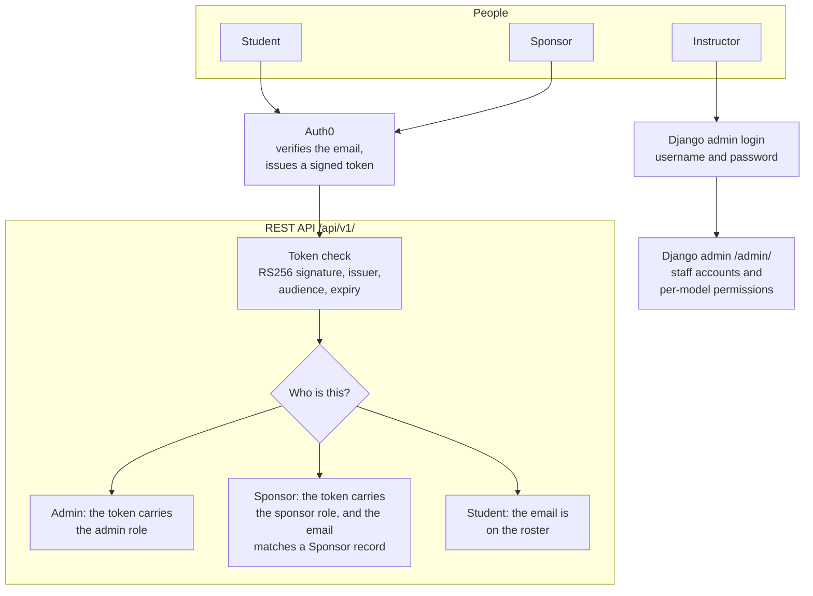

# Security Assessment

**Audience:** developers and the sponsor. What protects the site, what was checked and how, what is still open, and the checklist for keeping it that way.

Assessed 2026-11-20 against `main`. This is a review by the development team, not an outside penetration test.

## Summary

The application we inherited had no access control beyond "is logged in", and two groups of endpoints needed no login at all. That is fixed: every API endpoint now requires a valid Auth0 token and checks the caller's role, and students and sponsors can reach only their own records. The fixes are covered by automated tests that run on every pull request.

What remains is narrower. In order of importance:

| # | Open item | Risk |
|---|---|---|
| 1 | Two fixes found during this assessment are waiting for review: PR #118 (anyone with a university email could add themselves to the roster) and PR #116 (a sponsor's name was shown unescaped in the instructor's admin) | High until merged |
| 2 | 21 known advisories in frontend packages, 9 of them in packages that ship to the browser; 3 in the backend's token library | Medium |
| 3 | Any logged-in user can read the whole student and sponsor roster through the API | Medium |
| 4 | No backup of the database; uploaded files are lost on redeploy unless a bucket is configured | Medium (availability) |
| 5 | The accounts the site depends on belong to students | Medium (availability) |

The full list is under [Open findings](#open-findings).

## How it was assessed

| Method | What it covered | Result |
|---|---|---|
| Called every API endpoint as six kinds of user: not logged in, a student on the roster, a student token not on the roster, a sponsor, a logged-in user with no role, an admin | Who can read and write what | The [access table](#who-can-do-what) below. One defect found (item 1) |
| Read the code that renders user-typed text in Django admin | Stored script injection | One defect found (item 1) |
| `python manage.py check --deploy` on the production stack | Django's own deployment checklist | 4 warnings, listed below |
| `pip-audit` on `backend/requirements.txt` and `npm audit` on `frontend/package-lock.json` | Known vulnerabilities in dependencies | 3 backend, 21 frontend |
| Searched the repository and its history for secrets and committed `.env` files | Leaked credentials | None. Only the three example templates were ever committed |
| Checked the live site's headers and certificate from outside | HTTPS and response headers | HTTPS with redirect; `X-Frame-Options: DENY`, `nosniff`, `Referrer-Policy` present |
| Reviewed the existing security tests | That each fix is pinned by a test | 30 tests in three files, plus permission tests beside each feature |

Not done: testing against the live Auth0 tenant (the tests stand in for it), load or denial-of-service testing, and any review of the VM itself, which the author of this page has no access to.

## Who is who

There are two separate login systems, and it matters which one a person came through.

| Role | How it is established | Where in the code |
|---|---|---|
| Student | The token's email matches a row in the Students table, which only the instructor's roster import fills. The role in the token is not what makes someone a student | `student_for_user` in `backend/project/permissions.py` |
| Sponsor | The token carries the `sponsor` role, and ownership is decided by the token's email matching a Sponsor record | `sponsor_for_user`, same file |
| API admin | The token carries the `admin` role, assigned by hand in the Auth0 dashboard | `is_admin`, same file |
| Instructor | A Django staff account. Nothing to do with Auth0 | Django's own admin |

The email in a token can be trusted because the Auth0 Action refuses to issue a token until the email is verified.

## Who can do what

Each cell is the response observed on 2026-11-20. 403 means refused; 404 means the record is hidden from that user, so they cannot even confirm it exists.

| Action | Not logged in | Student | Sponsor | No role | Admin |
|---|---|---|---|---|---|
| List projects | 403 | Yes | Yes | Yes | Yes |
| Open a rejected project | 403 | 404 | 404 unless it is theirs | 404 | Yes |
| Create a project | 403 | 403 | Yes, under their own name only | 403 | Yes |
| Change another sponsor's project | 403 | 403 | 403 | 403 | Yes |
| See pending projects; approve or reject | 403 | 403 | 403 | 403 | Yes |
| Read semesters | 403 | Yes | Yes | Yes | Yes |
| Create or change a semester | 403 | 403 | 403 | 403 | Yes |
| List rankings | 403 | Their own only | None | None | All |
| Open another student's ranking | 403 | 404 | 404 | 404 | Yes |
| Save rankings for another student | 403 | 403 | 403 | 403 | Yes |
| List assignments | 403 | Their own team only | Their projects' teams only | None | All |
| Create or change an assignment | 403 | 403 | 403 | 403 | Yes |
| List attachments of visible projects | 403 | Yes | Yes | Yes | Yes |
| Add or delete an attachment on someone else's project | 403 | 403 | Refused | 403 | Yes |
| Read feedback | 403 | 403 | Their own only | 403 | All |
| **List all students; list all sponsors** | 403 | **Yes** | **Yes** | **Yes** | Yes |
| Change or delete a student or sponsor record | 403 | 403 | 403 | 403 | Yes |
| Send email through the API | 403 | 403 | 403 | 403 | Yes |
| Health check | Yes | Yes | Yes | Yes | Yes |

The "no role" column is a person who has logged in through Auth0 but is neither on the roster nor a sponsor. They can read the project list, the semesters, and the roster, and nothing else. The bold row is open finding 3.

Two rules the table cannot show:

- **Rankings close on the server.** After the semester's deadline the API refuses changes, whatever the browser sends.
- **A sponsor cannot move a record to someone else.** Naming another sponsor on a project, or another sponsor's project on an attachment or feedback, is refused in the serializer.

## What we inherited and what happened to it

The eight security gaps in the previous version, from [the v1 reference](../investigations/v1-reference.md), section 10.

| # | Inherited gap | Status | Evidence |
|---|---|---|---|
| 1 | No role checks on any endpoint | **Fixed** | Permission classes in `backend/project/permissions.py`; the table above |
| 2 | Semester and email endpoints needed no login; the email endpoints were an open mail relay | **Fixed** | All return 403 without an admin token |
| 3 | The role was chosen by the browser at signup | **Mostly fixed** | The Auth0 Action ignores the hint and decides from the Auth0 role or the email domain. The signup page still sends the unused hint. #77 |
| 4 | The ranking deadline was enforced only in the browser | **Fixed** | Server-side check in the preferences endpoint |
| 5 | Every student received every student's rankings and assignments | **Fixed** | Scoped in the queries; the table above |
| 6 | Signing keys fetched on every request; the algorithm was read from the token itself | **Fixed** | [JWT hardening](auth0-jwt-hardening.md), [key cache](jwks-cache-debug-panel.md) |
| 7 | A DEBUG button showed the logged-in user's full Auth0 record | **Fixed** | Removed. [Key cache and debug panel](jwks-cache-debug-panel.md) |
| 8 | Admin email forms accepted an SMTP password in the request | **Fixed** | The mail server comes only from server settings; posted values are ignored |

## Controls in place

| Area | Control |
|---|---|
| Tokens | RS256 only, whatever the token's header claims. The key must match one Auth0 publishes. Issuer, audience, and expiry are checked. Errors returned to the caller are generic. Keys are cached for five minutes, with a 30-second limit on forced refreshes so that made-up key IDs cannot be used to flood Auth0 |
| Access | Hidden records return 404, forbidden actions return 403. Scoping is done in the database query, so a record a user may not see is never loaded for them |
| Rejected projects | Visible only to the instructor and the owning sponsor, in lists, in detail, in attachments, and in downloads |
| Uploads | Seven allowed file types, 25 MB limit, stored under a random name, always sent back as a download with a safely quoted filename, never displayed in the page |
| Email | Only admins can send. Every send is logged. Student emails are refused unless explicitly enabled, so a test cannot mail a real class |
| Django admin | Sessions end after 20 minutes idle and when the browser closes. Actions that change data require the matching model permission, including the roster import and proposing teams. The email log is read-only |
| Team proposals | A proposal is carried in a token signed with the server's secret and valid for one hour, so it cannot be edited between review and approval |
| Transport | HTTPS with an automatic certificate; HTTP redirects. The database and the backend are not reachable from the internet |
| Secrets | Read from files on the server that Git ignores. None are in the repository or its history |
| Containers | The production backend runs as a non-root user |
| Dependencies | Every backend package is pinned to an exact version |

## Open findings

Severity is the team's judgment: **High** could expose or corrupt a class's data, **Medium** needs a logged-in user or affects availability, **Low** is hardening.

| # | Finding | Severity | What to do | Tracked |
|---|---|---|---|---|
| 1a | `POST /profile/` created a Student record for any token with the student role, which Auth0 gives to every verified `@crimson.ua.edu` address. Someone outside the class could add themselves, rank projects, and be placed on a team | High | Merge the fix | PR #118 |
| 1b | The admin project list showed the sponsor's self-typed name without escaping it | High | Merge the fix | PR #116, #7 |
| 2a | `npm audit`: 21 advisories (14 high, 7 moderate). 9 are in packages that ship to the browser, including `axios` and `vue`; the rest are in build and test tools | Medium | `npm audit fix`, run the tests, rebuild | None yet |
| 2b | `pip-audit`: 3 advisories, in `python-jose` and its dependency `ecdsa`, with no fixed version listed. This is the library that verifies tokens | Medium | Read the advisories against how we use it (RS256 only). Consider moving to PyJWT, which is actively maintained | None yet |
| 3 | Any logged-in user can list every student and sponsor with their email | Medium | Scope the two list endpoints the way assignments are scoped | [User records](user-records.md) |
| 4 | No database backup; uploads live inside the container unless `GS_BUCKET_NAME` is set | Medium | See the [deployment guide](../deployment-guide/README.md) | #83 |
| 5 | The Google Cloud project, the domain, the Auth0 tenant, and the sending mail account are tied to students' accounts | Medium | Hand each to the instructor; make her an Auth0 tenant admin | #45, [FAQ](../faq/README.md) |
| 6 | The Auth0 Action decides "student" from the email domain, and the signup page still sends a role hint | Low once 1a is merged | Finish server-side roles as ADR-002 describes | #77 |
| 7 | The live site may still use the previous team's Auth0 tenant | Medium | Switch it and redeploy | #58 |
| 8 | `check --deploy` warnings: session and CSRF cookies are not marked secure, no HSTS, no HTTPS redirect in Django (Caddy already redirects) | Low | Set the four settings when `DEBUG` is off | None yet |
| 9 | No rate limiting on the API | Low | Add DRF throttling, at least on the profile and preferences endpoints | None yet |
| 10 | Uploads are checked by file extension only, with no content check or virus scan; zip is allowed | Low | Check the file signature; consider dropping zip | [File hosting](../investigations/file-hosting.md) |
| 11 | Any logged-in student can download any visible project's files | Ask the sponsor | Restrict if project files are confidential | [Attachment permissions](attachment-feedback-permissions.md) |
| 12 | The API's HTML browsing pages are enabled in production | Low | Use only the JSON renderer when `DEBUG` is off | None yet |
| 13 | A real Auth0 key rotation has never been rehearsed | Low | Rotate the key on a test tenant and confirm logins continue | [Key cache](jwks-cache-debug-panel.md) |
| 14 | The tests replace Auth0 with a stand-in; no test logs in for real | Low | One browser test of login | None yet |

## Maintenance checklist

### Every deployment

- [ ] The tests on `main` are green.
- [ ] Back up the database first.
- [ ] After deploying, `/api/v1/health/` is healthy and `/admin/` loads.
- [ ] `DEBUG=0` on the server. Never switch it on to investigate a problem; read the logs.

### Start of every semester

- [ ] Remove last semester's students from the Students table before importing the new roster. An import never removes anyone, and anyone on the roster can log in as a student.
- [ ] In Django admin, deactivate staff accounts that are no longer needed.
- [ ] In the Auth0 dashboard, check who holds the `admin` role and who is a tenant member.
- [ ] Run `pip-audit -r backend/requirements.txt` and `npm audit` in `frontend/`. Upgrade what is flagged, run the tests, redeploy.
- [ ] Run `python manage.py send_deadline_reminders --dry-run` and read the list before the first real reminder.
- [ ] Test a restore from backup once.

### When a developer or instructor leaves

- [ ] Deactivate their Django staff account.
- [ ] Remove them from the Auth0 tenant members and from the `admin` role.
- [ ] Remove their access to the Google Cloud project and the GitHub repository.
- [ ] If they knew the server's secrets, change `SECRET_KEY`, the database password, and the SMTP password. Changing `SECRET_KEY` logs every admin out, which is the intended effect.

### When adding a feature

- [ ] A new endpoint sets `authentication_classes` and a permission class. There is no global default; an endpoint without them is open.
- [ ] Records are filtered in `get_queryset` for the calling user, not after loading.
- [ ] Ownership on create is checked in the serializer.
- [ ] HTML built in Python uses `format_html` with arguments, never an f-string.
- [ ] Tests cover the caller who should be refused, not only the one who should succeed.

### If something goes wrong

1. Take a database backup before changing anything, so the state can be examined later.
2. If an account is misused, deactivate it (Django admin for staff, the Auth0 dashboard for students and sponsors).
3. If a secret may have leaked, change it on the server and recreate the backend.
4. *Emails > Email logs* in Django admin shows every message the site sent, and `docker compose logs backend` shows every request.
5. Tell the instructor. Student records are covered by FERPA, and the university has its own reporting process.

## Detailed records

| Page | Covers |
|---|---|
| [Auth0 JWT hardening](auth0-jwt-hardening.md) | Pinning the token algorithm and requiring a key ID |
| [JWKS cache and debug panel](jwks-cache-debug-panel.md) | Caching Auth0's signing keys; removing the debug overlay |
| [User records](user-records.md) | Admin-only writes to student and sponsor records |
| [Attachment and feedback permissions](attachment-feedback-permissions.md) | Owner-or-admin rules for attachments and feedback |
| [ADR-002](../decisions/ADR-002-auth.md) | Why Auth0 was kept and how roles are meant to be decided |
| [v1 reference](../investigations/v1-reference.md) | The state of the application when this team received it |
