# Capstone Design Manager: User Guide

## Contents

1. [Introduction](#introduction)
2. [Getting Started](#getting-started)
3. [Student Guide](#student-guide)
4. [Sponsor Guide](#sponsor-guide)
5. [Instructor Guide](#instructor-guide)
6. [FAQ and Troubleshooting](#faq-and-troubleshooting)

---

## Introduction

The **Capstone Design Manager** is the website the UA Computer Science capstone course (CS 495) uses to match student teams with real-world projects. It replaces the spreadsheets and emails that used to carry this work.

This guide explains, step by step, how to use the site. It is written for people with no technical background: you do not need to know anything about how the site is built.

### Who this guide is for

| If you are... | Read | You will learn how to... |
|---|---|---|
| A **student** in CS 495 | [Student Guide](#student-guide) | browse projects, rank your choices, and find your team |
| A **sponsor** offering a project | [Sponsor Guide](#sponsor-guide) | submit and edit a project, attach files, see your team, give feedback |
| The **instructor** | [Instructor Guide](#instructor-guide) | set up a semester, approve projects, import students, build and publish teams |

### How to use this guide

- Read [Getting Started](#getting-started) first. It is short and applies to everyone.
- Then jump to the section for your role. Every role section begins with **what you can and cannot do**.
- If something goes wrong, see [FAQ and Troubleshooting](#faq-and-troubleshooting).

Only students who submitted preferences for the semester are included.

**Approving publishes the assignments.** While you are only proposing or moving students, nothing is saved and nobody else can see it. The moment you approve, each assigned student can see their project, the sponsor's contact details and their teammates' names and emails, and each sponsor sees the students on their own projects, with their names and emails. Nobody sees another team. Assigning a student by hand from the Preferences list, without a proposal, shows them the same way right away.
> [!NOTE]
> A separate, more technical FAQ for developers and for whoever hosts the site is in [`docs/faq/`](../faq/). This guide does not cover installing or hosting the site.

---

## Getting Started

### What the platform does

Each semester follows the same path. Every role plays a part:

```
Sponsors submit projects
        |
        v
Instructor reviews them and approves the ones to offer
        |
        v
Students browse the approved projects and rank their choices (before the deadline)
        |
        v
Instructor proposes teams, adjusts them if needed, and approves them
        |
        v
Students and sponsors see the final teams
```

### What the platform can do

| Capability | Who uses it |
|---|---|
| Submit a project proposal, edit it later, attach files and links | Sponsors |
| Review submitted projects and approve or reject them | Instructor |
| Browse the projects offered this semester | Students |
| Rank projects (5 high, 5 medium, 5 low) before the deadline | Students |
| Import the class roster from Blackboard | Instructor |
| Build teams automatically from the rankings, then adjust them by hand | Instructor |
| Show each student their project, sponsor contact and teammates | Students |
| Show each sponsor the students assigned to their projects | Sponsors |
| Send email: deadline reminders, assignment notices, sponsor invitations | The site, on the instructor's behalf |
| Collect sponsor feedback after the semester | Sponsors and instructor |

### Signing up and logging in

Open the site and you will see the login page.

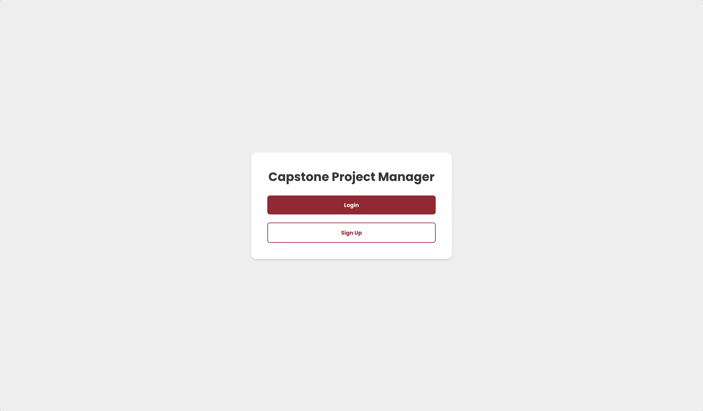

*Figure 1: The login page. Choose **Login** if you already have an account, or **Sign Up** if you are new.*

**If you are a student:**

1. Your instructor must first add you to the class list. Your university email address has to be on that list, because that is how the site recognizes you.
2. Click **Sign Up**, then **I am a Student**. Use your **@crimson.ua.edu** email address. Other addresses are refused.
3. Check your inbox for a verification email and click the link in it. If you cannot find it, look in your spam folder.
4. Return to the site and click **Login**.

**If you are a sponsor:**

1. Click **Sign Up**, then **I am a Sponsor**. Any email address works.
2. Verify your email the same way.
3. The first time you log in, you will see **Complete Your Profile**. Enter your first and last name, and, if you wish, your organization and phone number.

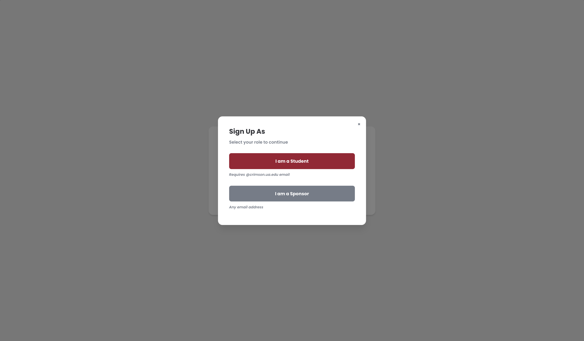

*Figure 2: The sign-up role picker. Students need a @crimson.ua.edu address; sponsors can use any address.*

**If you are the instructor:** you work in the site's administration area at `/admin/` (for example `https://your-site/admin/`) with an administrator account that the development team gives you. See the [Instructor Guide](#instructor-guide).

### Finding your way around

Students and sponsors get a menu on the left side of every page. It shows only the pages for your role, and has a **Logout** button at the bottom. Your name appears at the very bottom.

| Student menu | Sponsor menu |
|---|---|
| Dashboard | Dashboard |
| Project Gallery | Submit Project |
| Submit Rankings / Edit Rankings | Edit Project |
| View Assignment (once your team is posted) | Submit Feedback |
| Logout | Edit Profile |
| | Logout |

### What each role can and cannot do

| | Student | Sponsor | Instructor |
|---|---|---|---|
| See the projects offered this semester | Yes | Only their own | Yes, all |
| Rank projects | Yes, until the deadline | No | Can view all rankings |
| Submit a project | No | Yes | Can edit any |
| Approve or reject projects | No | No | **Yes** |
| Set team sizes and the deadline | No | No | **Yes** |
| See their own team | Yes | Yes, for their projects | Yes, all teams |
| See other teams | **No** | **No** | Yes |
| See other students' rankings | **No** | **No** | Yes |
| Import the class roster | No | No | **Yes** |

---

## Student Guide

### What you can and cannot do

**You can:**

- Browse every project the instructor has approved for your semester.
- Rank projects until the deadline, and change your rankings as often as you like before it.
- See your team, your project, your sponsor's contact details and your teammates' names and emails once teams are posted.

**You cannot:**

- Submit or edit projects (that is for sponsors).
- Change your rankings after the deadline.
- Choose your own team. The instructor builds the teams from everyone's rankings.
- See other teams, other students' rankings, or projects the instructor has not approved.

### Your dashboard

Your dashboard is the first page you see after logging in. It has three cards.

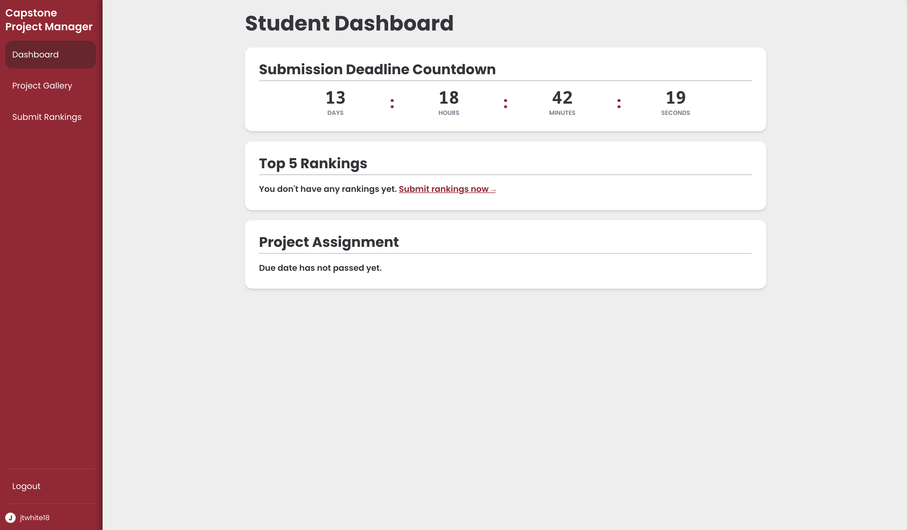

*Figure 3: The student dashboard. The countdown shows the time left to submit your rankings.*

| Card | What it shows |
|---|---|
| **Submission Deadline Countdown** | Days, hours, minutes and seconds left to submit your rankings. If the instructor has not set a deadline yet, it says "No submission deadline set." |
| **Top 5 Rankings** | Your highest-ranked projects. A link takes you to the ranking page. |
| **Project Assignment** | Before teams are posted: "Due date has not passed yet" (or "No assignment has been made yet" after the deadline). Once you are on a team: your project's name and a **View assignment** link. |

### Browsing projects

Click **Project Gallery** in the menu. Each card shows the sponsor and the start of the project description.

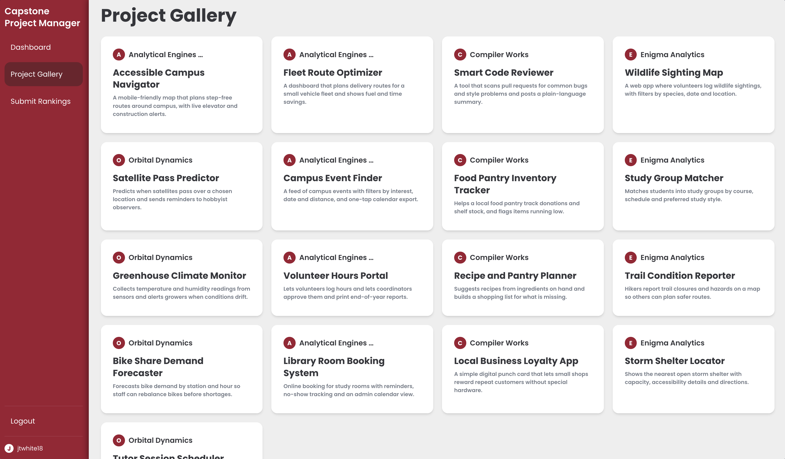

*Figure 4: The project gallery. Click a card to open its full description and any files or links the sponsor attached.*

Click a card to read the full description. A panel opens on the right; use its close button to hide it. Read the projects carefully before you rank them.

### Ranking projects

Click **Submit Rankings** (it changes to **Edit Rankings** after your first submission).

You must pick **exactly 5 projects for each level**: **High** (the ones you want most), **Medium** and **Low**. That is 15 projects in total.

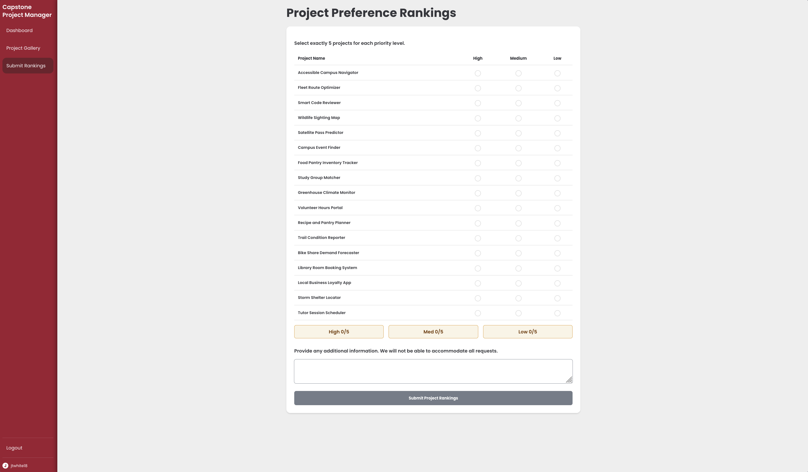

*Figure 5: The ranking page. Click a button in the High, Medium or Low column next to a project. The counters at the bottom (for example "High 3/5") show how many you have picked.*

1. Click a button in the **High**, **Medium** or **Low** column to choose a level for a project. Click it again to clear it. A project can have only one level.
2. Watch the counters at the bottom. Each one turns complete when it reaches 5.
3. Optional: use the comment box to tell the instructor anything that might help, such as a project you cannot work on. The note says "We will not be able to accommodate all requests." You can write up to 2,000 characters.
4. When all three counters show 5, the **Submit Project Rankings** button turns on. Click it, then confirm in the box that asks "Submit rankings?".

> [!TIP]
> You can come back and click **Edit Rankings** to change your choices any time before the deadline. Your last submission is the one that counts.

### After the deadline

When the deadline passes:

- The ranking page shows "The ranking deadline has passed. Submissions are closed." and you can no longer change anything.
- The **Edit Rankings** menu item goes away.
- The instructor builds the teams. This can take a little while, so check back.

### Finding out your team

When the instructor posts the teams, you will get an email titled "Your UA CS Capstone project assignment". Your dashboard's **Project Assignment** card now shows your project, and **View Assignment** appears in the menu once the deadline has passed.

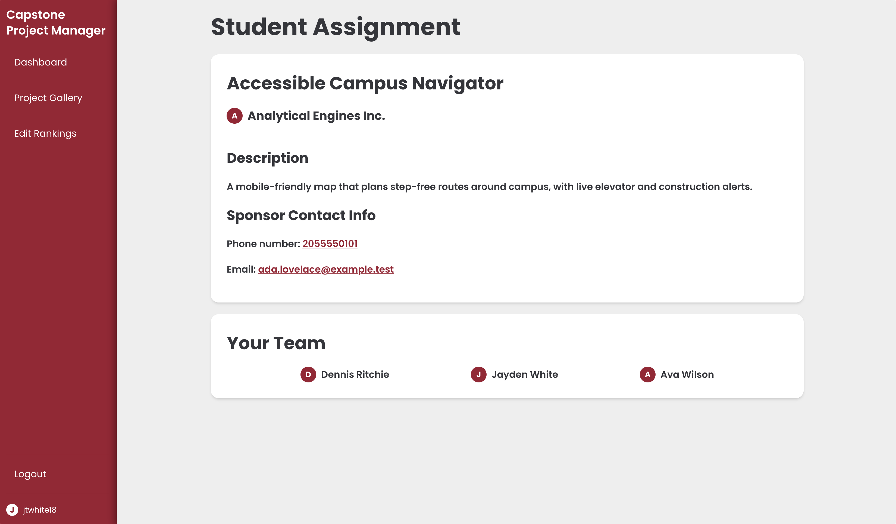

*Figure 6: The assignment page. It shows your project, your sponsor's contact details, and your team.*

The assignment page shows:

- **Your project**: its name and description.
- **Your sponsor's contact**: the sponsor's name, email and phone number.
- **Your team**: each teammate's name, with a link to email them. You are marked "(you)".

You can only see **your own team**. You cannot see other teams.

### Emails you may receive

| Email | When |
|---|---|
| Reminder to rank your preferences | A few days before the deadline, if you have not yet submitted rankings |
| "Your UA CS Capstone project assignment" | When the instructor posts the teams |

---

## Sponsor Guide

### What you can and cannot do

**You can:**

- Submit one or more project proposals.
- Edit your own projects, and attach files or links to them.
- See which students are assigned to your projects, with their names and emails, once teams are posted.
- Send feedback to the instructor about your project.
- Update your profile.

**You cannot:**

- Approve your own project. The instructor reviews every proposal.
- Choose which students work on your project. The instructor builds the teams from the students' rankings.
- Set the team size for your project. Ask the instructor if you need a smaller team.
- See other sponsors' projects or teams, or what students ranked.

### Your dashboard

Your dashboard lists each of your projects as a card.

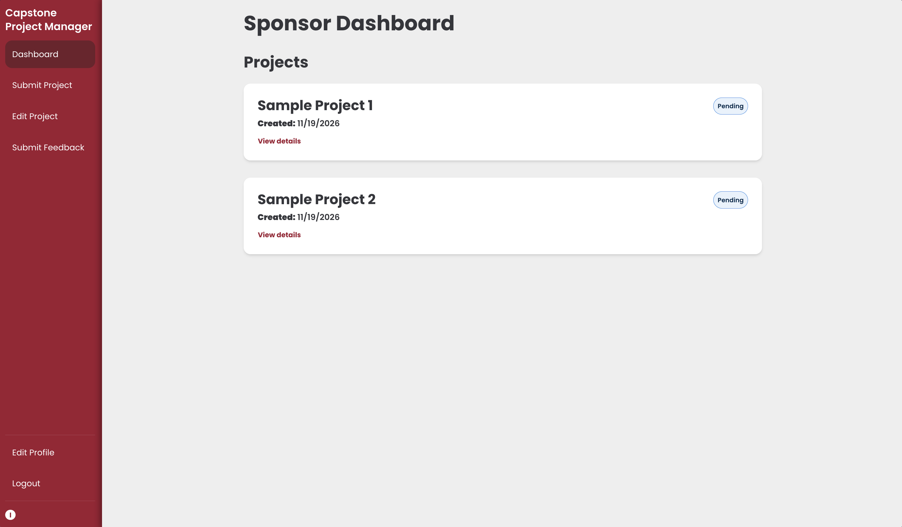

*Figure 7: The sponsor dashboard. Each card shows a project and its status; click **View details** to open it. Once teams are posted, each card also lists the students assigned to the project.*

Each card shows the project name and a short description. Click **View details** to see more, including the files and links attached to the project. Under **Assigned students** you will see:

- **"No students assigned yet."** before the instructor posts the teams.
- Each student's **name and email** once teams are posted. Click an email to write to them.
- **"Assigned students could not be loaded."** if there was a temporary problem. Reload the page.

### Submitting a project

Click **Submit Project** in the menu.

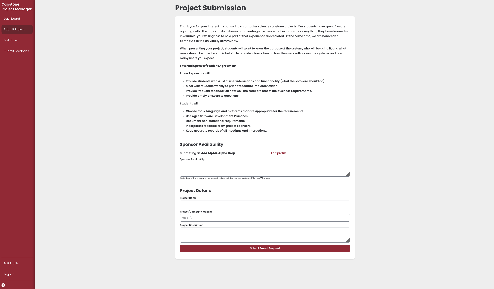

*Figure 8: The project submission form.*

1. Read the **External Sponsor/Student Agreement** at the top of the page. It explains what sponsors and students agree to.
2. Under **Sponsor Availability**, say which days of the week and times of day you can meet with students (morning or afternoon).
3. Under **Project Details**, enter:
   - **Project Name**
   - **Project/Company Website** (for example `https://example.com`)
   - **Project Description**: what the project is, who will use it, and what users should be able to do. The more detail, the easier it is for students to choose.
4. Click **Submit Project Proposal**.

### What happens after you submit

1. Your project is **Pending**. Students **cannot see it yet**.
2. The instructor reviews it. If it is approved, it is added to a semester and students can see and rank it.
3. If it is rejected, it is marked **Cancelled**. Students never see it, but you still see it on your dashboard, marked Cancelled. If you think this is a mistake, contact the instructor, who can approve it later.

You will not receive an automatic email about the decision, so check your dashboard or ask the instructor.

### Editing a project

Click **Edit Project**, choose the project from the list, change the name, website, description or availability, and click **Edit Your Project**. If you have no projects yet, the page links you to **Submit a Project**.

### Attaching files and links

On your dashboard, open a project's details to find the attachments area. Students (in the project gallery) and the instructor can see what you add.

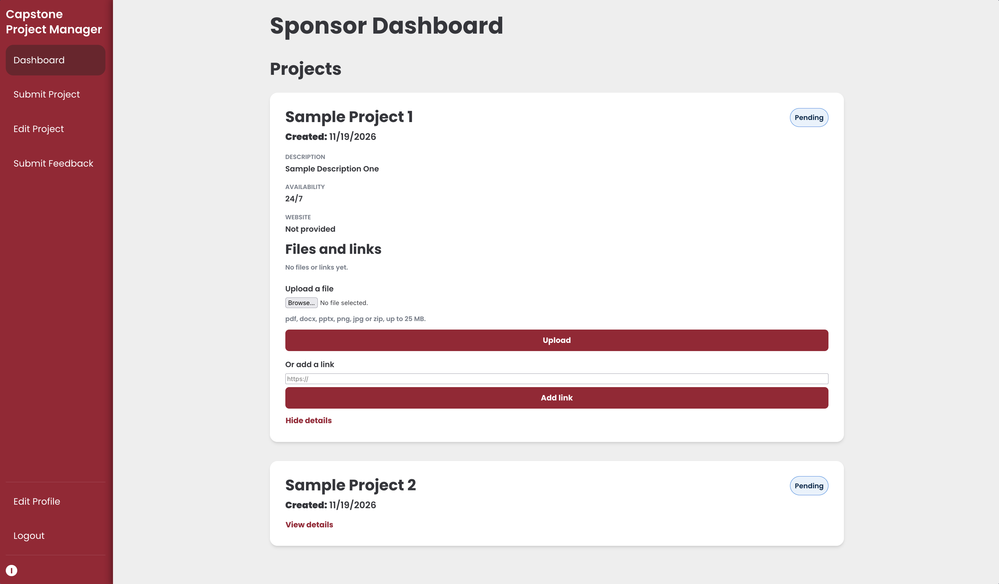

*Figure 9: Attachments. Upload a file or add a link; students can then see them in the project gallery.*

- **Upload a file**: pdf, docx, pptx, png, jpg or zip, up to **25 MB**. Choose the file and click **Upload**.
- **Add a link**: paste the address and click **Add link**.

### Submitting feedback

After the semester, click **Submit Feedback**. Choose the semester and the project, write your feedback, and click **Submit Sponsor Feedback**. The instructor reads it.

### Updating your profile

Click **Edit Profile** to change your name, organization or phone number.

---

## Instructor Guide

The instructor does most of the work in the site's **administration area**, which is at `/admin/` (for example `https://your-site/admin/`). Log in with the administrator account the development team gave you.

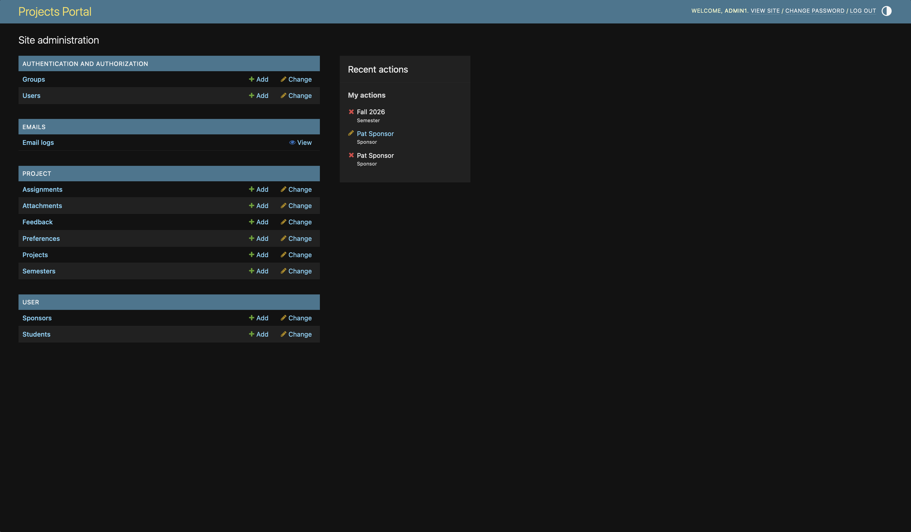

*Figure 10: The administration home page. Everything in this section starts here.*

### What you can and cannot do

**You can:**

- Create semesters and set the deadline and team sizes.
- Approve or reject sponsor projects.
- Import the class roster, and view or edit students and sponsors.
- See every student's rankings.
- Build teams, adjust them by hand, and publish them.
- Email sponsors.
- Read sponsor feedback.

**Good to know:**

- Your account may be limited. A staff account can only do what its permissions allow. If a button or action does not appear for you, ask the administrator to grant that permission. For example, **Propose assignments** needs the permission to assign.
- Students and sponsors cannot do any of the things above. They never see the administration area.

### The semester at a glance

| When | What you do | Section |
|---|---|---|
| Before the semester | Create the semester and set the deadline | [Set up a semester](#1-set-up-a-semester) |
| Before the semester | Import the class roster | [Import the class roster](#3-import-the-class-roster) |
| As sponsors submit | Review projects | [Review submitted projects](#2-review-submitted-projects) |
| Before the deadline | Invite sponsors by email (optional) | [Email sponsors](#4-email-sponsors-optional) |
| After the deadline | Check rankings, propose and approve teams | [Build and publish teams](#5-build-and-publish-teams) |
| After the semester | Read feedback | [Read sponsor feedback](#7-read-sponsor-feedback) |

### 1. Set up a semester

Go to **Semesters** and click **Add semester**.

| Field | What to enter |
|---|---|
| **Semester** | Fall, Spring or Summer |
| **Year** | The four-digit year (the current year or next) |
| **Assignment date** | The date and time the **ranking deadline** passes. Students cannot rank after this. They see a countdown to it. |
| **Team size** | The most students allowed on one project (default 4) |
| **Minimum team size** | The fewest students allowed on a project that gets a team (default 4) |
| **Projects** | The projects offered this semester. You can also add them later, by [approving projects](#2-review-submitted-projects). |

Click **Save**.

> [!NOTE]
> If the number of students does not divide evenly by the team size, lower the **Minimum team size**. For example, with 22 students and a team size of 4, a minimum of 3 lets the site build teams of 3 and 4. The site tells you if your settings cannot work.

To give one project a different limit, open that project and set **Max team size**. Leave it blank to use the semester's team size.

### 2. Review submitted projects

When a sponsor submits a project it is **Pending**, and students cannot see it. Review it here.

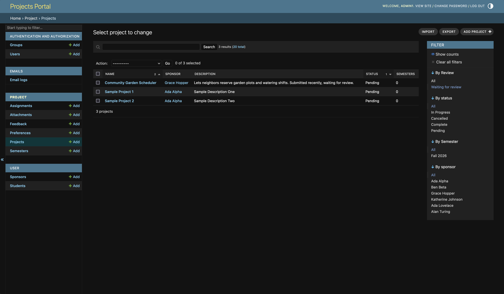

*Figure 11: The Projects list with the **Waiting for review** filter on the right.*

1. Go to **Projects**. On the right, under **Review**, choose **Waiting for review**. Each row shows the project, the sponsor and the start of the description. Click a project to read all of it.
2. To **approve**: tick the projects you want to offer, choose **Approve for a semester** from the **Action** menu, and click **Go**. Choose the semester (the current one is already selected) and confirm. Students in that semester can now see and rank those projects.
3. To **reject**: tick the projects you do not want, choose **Reject**, and confirm. They are marked **Cancelled** and removed from every semester. Students never see them. The sponsor still sees the project on their dashboard, marked Cancelled.

> [!NOTE]
> A rejected project can be approved later, which restores it. A project cannot be rejected once students are assigned to it. Move those students to another project first.

Other actions in the same menu: **Assign to a semester**, **Remove from semester**, and **Change status**.

### 3. Import the class roster

Students can only log in if their email is on the roster. You import the roster from the CSV file Blackboard gives you.

1. Go to **Students** and click **Import**.
2. Choose the file and set the file format to **csv**. Click **Submit**.
3. Check the preview. It lists each row as **New**, **Update** or **Skipped**. Nothing is saved yet.
4. Click **Confirm import**.

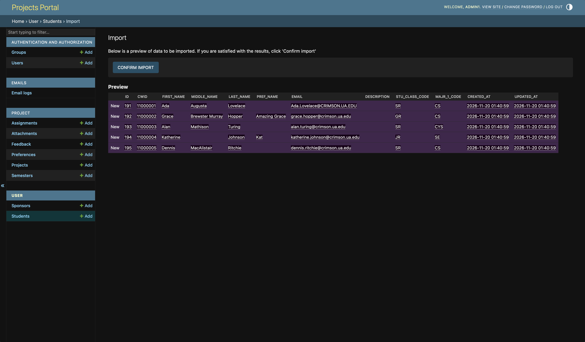

*Figure 12: The import preview. Review it before clicking **Confirm import**.*

**What the file needs:** the columns `EMAIL`, `FIRST_NAME`, `LAST_NAME` and `CWID` (the student's 8-digit ID). The columns `MIDDLE_NAME`, `PREF_NAME`, `STU_CLASS_CODE` and `MAJR_1_CODE` are optional.

**Good to know:**

- The file must be saved as **CSV UTF-8**. In Excel, choose *File > Save As > CSV UTF-8 (Comma delimited)*. A plain "CSV" file with accented names may be refused, and the page tells you how to fix it.
- You can import the same file again. Students are matched by CWID, so existing students are updated or skipped and nobody is duplicated.
- If some rows have problems (a bad ID, a bad email, a repeated student), the page lists the row numbers and reasons. The good rows still import; fix the bad ones and import again. Row 1 is the first row after the header.
- Importing adds and updates students but never removes them.

You can also add or edit a single student under **Students > Add student**.

### 4. Email sponsors (optional)

Under **Sponsors**, tick one or more sponsors and use the **Action** menu:

| Action | What it does |
|---|---|
| **Send Sponsor Outreach Email** | Invites sponsors to submit projects for a semester |
| **Export Sponsor Outreach as EML** | Creates the same email as a file you can open in your email program |
| **Send Project Presentation Email** | Sends each sponsor details for their project presentation (date, time, video call) |
| **Export Project Presentation as EML** | Creates that email as a file |

Each one shows you a **preview** first. Nothing is sent until you confirm. A record of sent emails is kept in the administration area.

### 5. Build and publish teams

Do this **after the ranking deadline**.

**Before you start:**

- Check **Preferences** to see what students submitted. The **Student Assigned** filter shows who does and does not have a team yet. Only students who submitted rankings are included in the proposal.
- Make sure the semester's projects are on the semester, and that the team sizes are right ([step 1](#1-set-up-a-semester)). Cancelled projects are skipped.

**Not sure which team size to use? Compare them first (optional):**

1. Go to **Semesters**, tick the one semester, choose **Compare team sizes** from the **Action** menu, and click **Go**.
2. Type the sizes to compare, separated by commas: `4` means teams of exactly 4, and `3-4` means teams of 3 to 4. Pick a fairness limit if you want one (see below), and confirm.
3. Each column shows what the solver would propose with that size: whether it can work, how many teams form, how many students get each choice, and the worst placement anyone gets. Nothing is saved, and the semester's own team size does not change.
4. Click **Open this proposal** under the column you prefer to review and approve it as usual. To make that size the default for the semester, edit the semester.

**Propose:**

1. Go to **Semesters**, tick the one semester, choose **Propose assignments** from the **Action** menu, and click **Go**.
2. Choose a **Fairness limit** if you want one, and confirm.
   - **No limit** gives the lowest total across the class. One student can end up much worse off than the rest.
   - **Nobody on a project they did not rank**, **Nobody below their second choice**, or **Everybody gets a first choice** keeps every student at or above that choice when that is possible. When it is not, the proposal keeps as many students within the limit as it can and says how many are beyond it.
3. If the settings cannot work for the number of students, a message says so and nothing is proposed. Change the team sizes and try again.

**Review the proposal:**

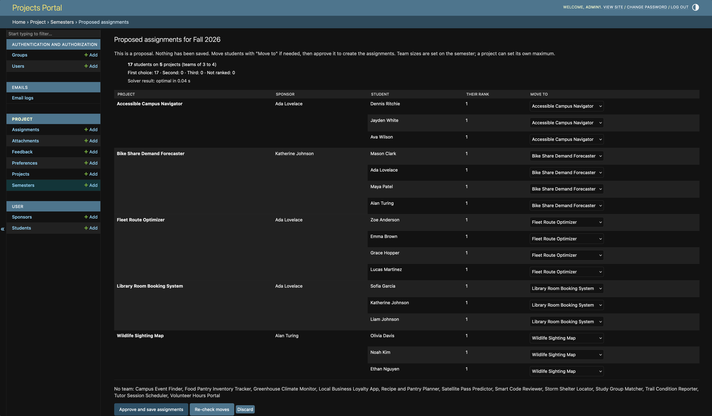

*Figure 13: The proposal page. Each project lists its students and the rank each gave it.*

- Each project is listed with its students and the **rank each student gave it**.
- The summary at the top shows the **worst placement** anyone got and, if you chose a fairness limit, whether it was met for every student.
- A student placed on a project they **did not rank** is shown in **red**.
- A project with its own maximum is marked "up to N students".
- Projects with no team are listed under the table.
- **Nothing has been saved yet.** Students and sponsors cannot see anything.

**Adjust (optional):**

- To change a team, choose a different project in a student's **Move to** list. The page re-checks right away: the student's rank updates, moved students are highlighted, and any team that is too big or too small is listed under **Fix these before approving**.
- **Approve and save assignments** stays disabled until every team is within the size limits.
- You can start a new team by moving students onto a project that has none.

**Approve and publish:**

- Click **Approve and save assignments** to save the teams, or **Discard** to leave everything as it was.
- What you approve is exactly what is on the page, including your moves. A proposal expires after an hour. If it does, propose again.

> [!IMPORTANT]
> **Approving publishes the teams.** The moment you approve, every student can see their project, their sponsor's contact details and their teammates, and every sponsor can see the students on their projects. Students are emailed their assignment. Approving again replaces the project of any student who already had one that semester.

**To assign one student by hand** (without a proposal): go to **Preferences**, tick the student's row, choose **Assign to project**, and pick the project. This also shows up for the student and sponsor straight away.

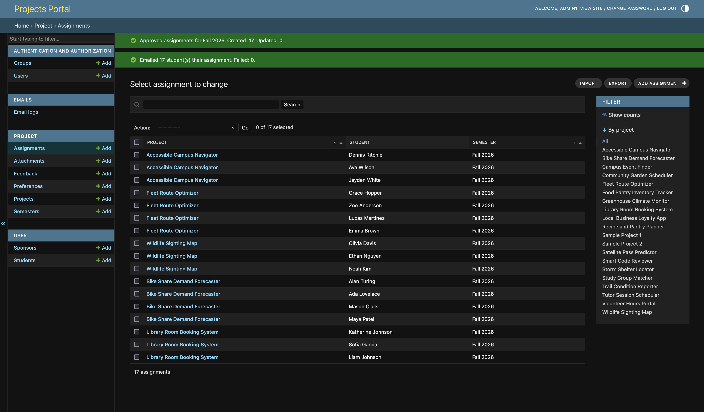

*Figure 14: The **Assignments** list shows every project, student and semester after you approve.*

### 6. Deadline reminders

The site can email students who have not submitted rankings a few days before the deadline (3 days by default, once per semester). If you do not see reminders going out, ask the development team to check that this is switched on.

### 7. Read sponsor feedback

Go to **Feedback** to read what sponsors submitted, with their project and semester.

### What the instructor cannot do from the site

- Students' rankings are changed only by the student, before the deadline. To place a student on a project yourself, use **Assign to project** under [Build and publish teams](#5-build-and-publish-teams).
- Sponsors and students are not notified automatically when you reject a project. Tell the sponsor yourself.
- The site does not delete students from past semesters when you import a new roster. Ask the development team if you need students removed.

---

## FAQ and Troubleshooting

Short answers for common questions. For technical questions (installing, hosting, accounts, errors in the administration area), see the [technical FAQ](../faq/).

### Logging in

<details>
<summary><strong>I cannot sign up as a student.</strong></summary>

Student accounts need a **@crimson.ua.edu** email address. If you tried another address, sign up again with your university email, or ask your instructor to add you.
</details>

<details>
<summary><strong>I see "Access Denied" after logging in.</strong></summary>

Your email is not on the class list. This usually means you are not in CS 495, or the instructor has not imported the roster yet. Contact your instructor and make sure they have your @crimson.ua.edu address.
</details>

<details>
<summary><strong>I see "Authentication Error: No role found in your account".</strong></summary>

Your account does not have a role (Student or Sponsor) yet. Contact your instructor or administrator and ask them to assign one.
</details>

<details>
<summary><strong>I never got the verification email.</strong></summary>

Check your spam folder first. The email comes right after you sign up. If it is not there, wait a few minutes, then contact your instructor.
</details>

### For students

<details>
<summary><strong>I cannot edit my rankings.</strong></summary>

Rankings close at the deadline shown on your dashboard. After that, nothing can be changed. If you have a real problem, email your instructor.
</details>

<details>
<summary><strong>The Submit button is grey.</strong></summary>

You must pick exactly **5 High, 5 Medium and 5 Low** projects. Check the counters at the bottom of the page, and fix any that are not at 5.
</details>

<details>
<summary><strong>I do not see "View Assignment" in my menu.</strong></summary>

It appears only after the ranking deadline, and only once the instructor has posted the teams. Your dashboard's **Project Assignment** card tells you where things stand.
</details>

<details>
<summary><strong>I did not get the assignment email.</strong></summary>

Check your spam folder. You can also log in. Your assignment is on your dashboard even if the email is delayed.
</details>

<details>
<summary><strong>Can I choose my teammates?</strong></summary>

No. The instructor builds the teams from everyone's rankings. Use the comment box on the ranking page to share anything the instructor should know.
</details>

### For sponsors

<details>
<summary><strong>My project is not visible to students.</strong></summary>

New projects are **Pending** until the instructor approves them. Ask your instructor if it has been reviewed.
</details>

<details>
<summary><strong>My project says "Cancelled".</strong></summary>

The instructor rejected it. Students cannot see it. Contact your instructor to ask why, or to have it reconsidered.
</details>

<details>
<summary><strong>My dashboard says "No students assigned yet".</strong></summary>

Teams are not posted yet. Once the instructor approves the teams, the students appear here automatically.
</details>

<details>
<summary><strong>My file will not upload.</strong></summary>

Files must be pdf, docx, pptx, png, jpg or zip, and no larger than 25 MB. For larger material, add a link instead.
</details>

### For the instructor

<details>
<summary><strong>The team proposal says the settings cannot work.</strong></summary>

The team size and minimum do not fit the number of students. Lower the **Minimum team size** (for example from 4 to 3), or raise the **Team size**, or add projects to the semester. Then try again.
</details>

<details>
<summary><strong>"Approve and save assignments" is greyed out.</strong></summary>

A team is too big or too small. Look under **Fix these before approving** and move students until every team is within the limits.
</details>

<details>
<summary><strong>A student cannot log in.</strong></summary>

Check that their @crimson.ua.edu address is in **Students**, spelled exactly as they sign up. Add or fix it, then ask them to try again.
</details>

<details>
<summary><strong>The roster import shows errors.</strong></summary>

Read the row numbers and reasons on the page. Fix those rows in the file and import again; rows that already imported are skipped.
</details>

<details>
<summary><strong>I do not see an action (for example Propose assignments).</strong></summary>

Your account does not have permission. Ask the administrator to grant it.
</details>

### Still stuck?

Contact your instructor. If you are the instructor, contact the development team and include what you were doing, what you expected, and what you saw (a screenshot helps).
